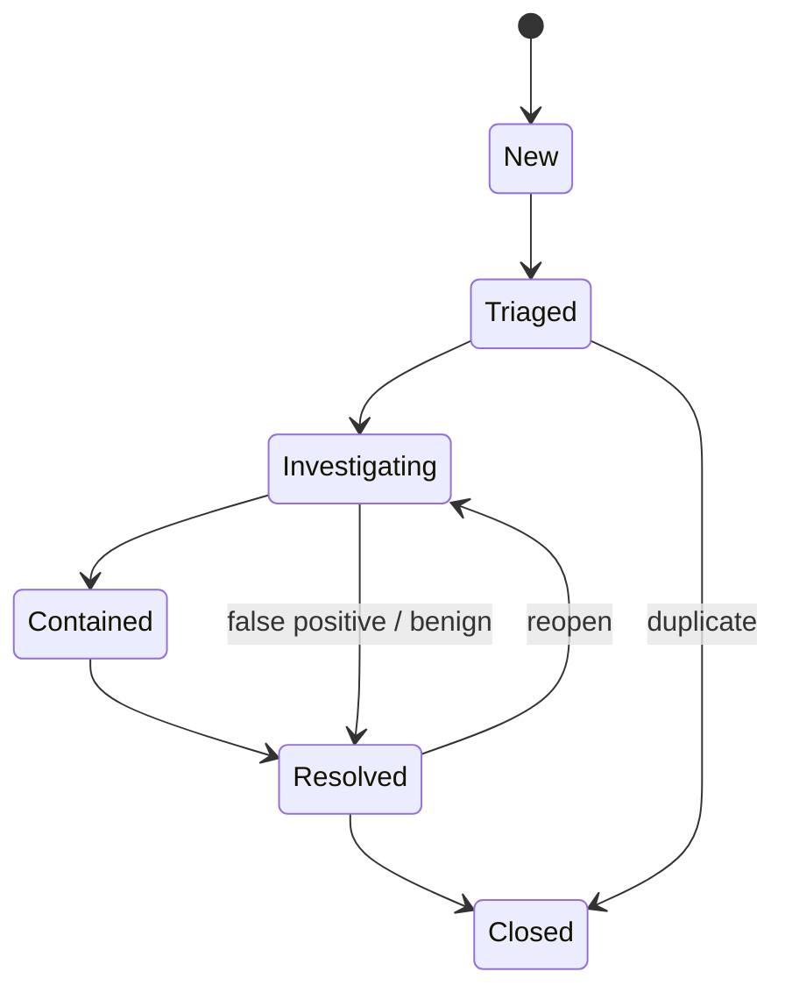
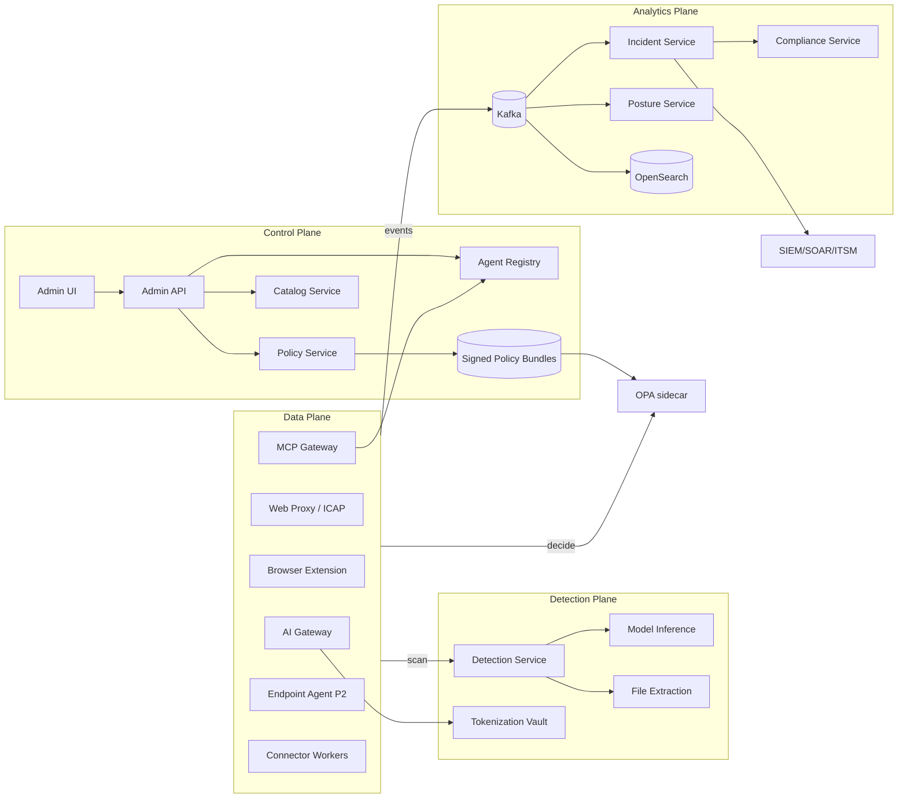
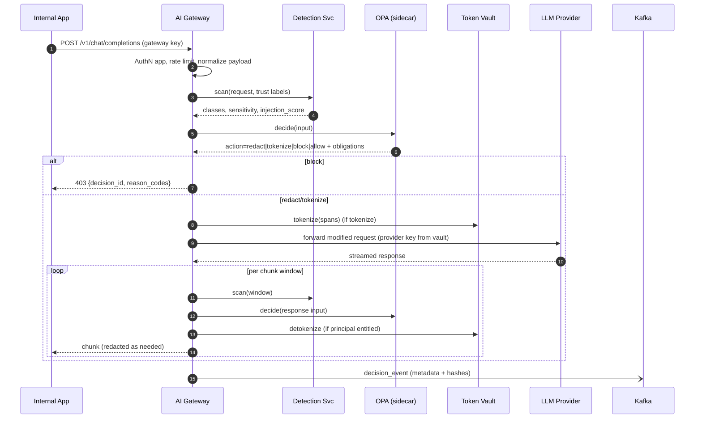
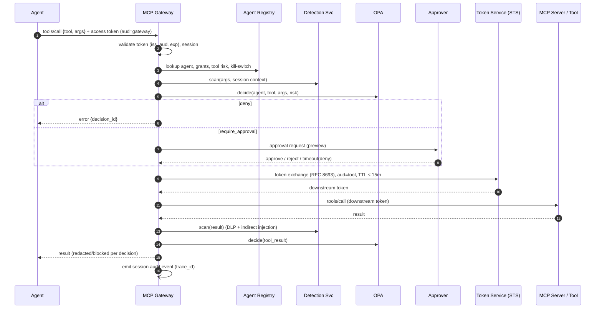
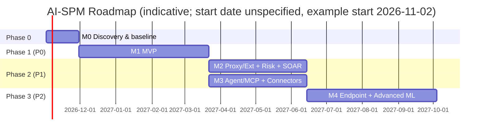

<!-- source-sha256: 4d11c41face02b44 -->
# Spec: Enterprise AI Data Security & AI Security Posture Management (AI-SPM)

Status: draft-1
Date: 2026-10-01
Original sources: `docs.md`, `docs2.md` (summary of deliverables; the original `spec.md` is not available, this document was reconstructed and re-verified against primary sources as of 2026-10-01)
Owner: `unspecified`

> Conventions: **MUST / SHOULD / MAY** follow RFC 2119. Values not yet known are marked `unspecified`. Assumptions are marked **[ASM-n]**, decisions are marked **[DEC-n]**.

---

## 0. Executive Summary

This platform controls the movement of sensitive data to, from, and through AI (public GenAI apps, internal AI apps, and AI agents). All paths (prompts, file uploads, responses, agent tool calls, data-at-rest consumed by AI) are treated as data channels that must be **discovered, classified, risk-assessed, and subjected to policy**.

Main architecture decision **[DEC-1]**: *hybrid enforcement architecture*. No single control point is sufficient. All enforcement points call one **Detection Plane** and one **Policy Decision Point (OPA)**, then write to one **Event + Incident Pipeline**.

```text
Users / Browsers ───────► Inline Web Proxy / Browser Ext ─┐
Internal AI Apps ───────► AI API Gateway (P0) ────────────┤
AI Agents ──────────────► Agent / MCP Gateway (P1) ───────┤
Managed Endpoints ──────► Endpoint Agent (P2) ────────────┼─► Detection Plane ─► Policy Engine (OPA)
Cloud / SaaS ───────────► API Connectors (P0/P1) ─────────┘      (classify,          │
                                                                  prompt security,   ▼
                                                                  risk score)   allow | warn | redact |
                                                                                tokenize | block |
                                                                                quarantine | approval
                                                                                     │
                                                                                     ▼
                                                        Event + Incident Pipeline ─► Posture / Investigation / Compliance
```

Enforcement priorities:
- **AI Gateway: P0.** The most deterministic enforcement for app-to-LLM.
- **Web proxy + SaaS connectors: P0/P1.** Handles shadow AI and posture.
- **Agent/MCP Gateway: P1.** Agents must not use privileges and tools without governance.
- **Endpoint agent: P2.** Highest cost of build, deployment, OS compatibility, and maintenance.

---

## 1. Product Definition

### 1.1 Vision
Organizations can adopt AI (sanctioned AI, internal LLM apps, autonomous agents) without losing control over sensitive data. Every AI interaction must also be provable to regulators and auditors.

### 1.2 Problem Statement
1. **Shadow AI.** Employees use public GenAI services and personal accounts without IT visibility. Customer data, code, and internal documents leave through prompts and uploads.
2. **Existing DLP controls are blind to AI context.** Classic DLP does not understand prompts, streaming responses, embeddings/RAG, or agent tool calls.
3. **LLM-specific attacks.** Examples include direct/indirect prompt injection, jailbreaks, system prompt leakage, and excessive agency. Regex or keyword filtering alone is inadequate: attacks can be encoded, multilingual, or take the form of optimized adversarial suffixes (Zou et al. 2023).
4. **Oversharing of data-at-rest.** Copilot/RAG inherits overly loose ACLs, so AI can "discover" data that is technically accessible but should not be.
5. **Agent autonomy.** Agents hold long-lived credentials, access tools through MCP/APIs, and act without an audit trail or human approval.
6. **Regulatory obligations.** Indonesia's Personal Data Protection Law (UU PDP, Law No. 27/2022), with breach notification within 3×24 hours (72 hours); POJK 11/2022 (OJK Regulation 11/POJK.03/2022 on bank IT governance and data location); the AI Governance Guide for Indonesian Banking (2025) from OJK, Indonesia's Financial Services Authority, and the EU AI Act (if relevant).

### 1.3 Principles
- **P1 Data-centric.** Policy is attached to data classification and context, not only to domain or application.
- **P2 Decision ≠ enforcement.** All PEPs call the same PDP, so one policy applies across all channels.
- **P3 Defense-in-depth.** Deterministic (regex, checksum), statistical (ML), and architectural (least privilege, HITL, separation of instructions and data) measures are used together. No single detector is a single point of trust.
- **P4 Privacy by default.** Raw content is not stored by default. Only metadata, hashes, and already-redacted snippets are stored.
- **P5 Explainable decisions.** Every decision carries `reason_codes`, the policy version, and the model version.
- **P6 Versioned everything.** Policies, detector models, and framework mappings are versioned. Example: NIST AI RMF is being revised, so mappings must not be hard-coded.
- **P7 Explicit fail mode.** Every PEP has a `fail_open | fail_closed` configuration per policy (see §13.3).

### 1.4 Non-Goals (v1)
- Does not build its own LLM/foundation model.
- Does not replace SIEM/SOAR/ITSM; this platform only integrates with them.
- Does not perform full model red-teaming or model scanning (model supply chain). Candidates for P2+ or third-party integration.
- Does not control content that has no technical path. Example: photographing the screen with a personal phone.
- Does not claim to "prevent 100% of prompt injection". The realistic target is to reduce the attack success rate and limit the blast radius.
- Does not cover bias/fairness of credit models. That belongs to model risk management, not this platform.

### 1.5 Success Metrics
| Metric | Target 6 months post-GA | Notes |
|---|---|---|
| Visible AI traffic coverage (discovered/total AI egress) | ≥ 95% for traffic via proxy | Baseline measured in phase 0 |
| Shadow AI apps identified & given a sanction status | ≥ 90% of top-100 by usage | |
| Precision of P0 sensitive data detectors (PII ID, PCI, credentials) | ≥ 0.95 | On internal eval set |
| Recall of P0 detectors | ≥ 0.90 | |
| FPR of prompt-injection classifier on benign traffic | ≤ 1% | Prevents alert fatigue |
| Attack success rate (internal AgentDojo-style suite) with gateway active | down ≥ 70% vs baseline | |
| Additional inline latency p95 (text ≤ 8K tokens) | ≤ 80 ms | §13 |
| MTTD for critical incidents | ≤ 5 minutes | |
| Time to prepare breach report (material for UU PDP notification) | ≤ 24 hours | Legal limit is 72 hours |
| Active agents with no owner & no policy | 0 | |

---

## 2. Users & Personas

| Persona | Primary needs | Default access rights |
|---|---|---|
| **CISO** | Posture trends, top risks, evidence for the board/regulators | Read dashboard, report |
| **SOC Analyst** | Alert triage, investigation, fast containment | Incidents RW, evidence read (redacted) |
| **Security Admin** | PEP, connector, and integration configuration | Config RW |
| **DLP Analyst** | Classifier & policy tuning, simulation, exceptions | Policy RW (publishing needs approval) |
| **Compliance / DPO** | Control mapping, audit evidence, UU PDP breach report | Compliance RW, evidence unmask (with justification) |
| **AI Engineer / App Owner** | SDK/gateway integration, key management, false-positive feedback | App-scoped read, feedback |
| **Agent Owner** | Agent registration, tool scope, HITL approval | Agent-scoped RW |
| **Auditor (internal/external)** | Tamper-proof audit trail, control history | Read-only, time-boxed |
| **End User (employee)** | Knows why something was blocked, can request an exception | Self-service coaching & request |

---

## 3. Scope & MVP

### 3.1 Priorities
**P0 (MVP, Phase 1):**
- AI API Gateway (OpenAI-compatible + Anthropic + Azure OpenAI + Gemini + self-hosted) with prompt and response inspection.
- Detection: regex + checksum + secret detection + Indonesian PII NER + prompt-injection classifier v1.
- Policy engine (OPA): allow, warn, redact, block. Versioning, simulation, and rollback are available.
- AI app catalog + shadow AI discovery from existing proxy/SWG logs (log ingest, not inline).
- Event pipeline, basic incident management, posture dashboard.
- RBAC, SSO (OIDC/SAML), audit log with hash chain.
- SIEM integration (syslog/CEF + HTTP).

**P1 (Phase 2):**
- Inline web proxy / browser extension for public GenAI (prompt, upload, paste).
- Agent/MCP Gateway: agent identity, tool allow-list, short-lived credential, HITL approval, kill switch.
- SaaS/data connectors (M365, Google Workspace, S3/GCS/Blob, file share): data-at-rest scan, ACL/oversharing analysis.
- Additional actions: tokenize, quarantine, approval, remediation (delete/change share links).
- Full risk scoring + incident correlation/dedup, SOAR/ITSM integration.
- Compliance module: evidence mapping + report.

**P2 (Phase 3):**
- Endpoint agent (Windows/macOS): clipboard, file-to-AI desktop app, local AI agent.
- Embedding similarity for confidential IP/documents (exact/near-duplicate fingerprint).
- Custom classifier training per tenant, active learning.
- Agent behavior analytics (anomalies in tool call sequences).
- Multi-region / multi-tenant SaaS.

### 3.2 Definition of Done (per feature)
1. The related FR requirements pass automated acceptance tests.
2. Unit coverage ≥ 80% on decision logic modules (detection, policy, risk).
3. The §13 latency/throughput targets are met under load test.
4. Threat model (STRIDE + OWASP LLM/ASI) is documented and high findings are closed.
5. Metrics, traces, and logs are in place (§12.3). Runbook is available.
6. No raw content in logs/telemetry (checked by automated test).
7. API documentation (OpenAPI) and admin guide are updated.

---

## 4. Functional Requirements

### 4.1 AI Discovery & App Catalog (FR-DISC)
- **FR-DISC-1** The system MUST maintain an AI app catalog: `vendor, app, domains[], api_endpoints[], category (chat, code, image, agent, embedding, meeting, plugin/extension), data_retention_policy, trains_on_customer_data, hosting_region, ojk_approval_ref, certifications, risk_tier`.
- **FR-DISC-2** Fingerprinting MUST support:
  - domain/SNI
  - URL path pattern
  - API signature (for example `POST /v1/chat/completions`, `POST /v1/messages`, `:generateContent`)
  - distinctive headers (`anthropic-version`, `openai-organization`)
  - SDK user-agent
  - JSON payload shape (`messages[]`, `model`, `stream`)
- **FR-DISC-3** Every app detection has a `confidence` of 0–1: `confidence = 1 − Π(1 − c_i)` over independent signals i. Initial weights: catalog domain = 0.9, API signature = 0.8, payload shape = 0.6, SDK UA = 0.5. Apps with confidence < 0.6 go to the review queue.
- **FR-DISC-4** Sanction status: `sanctioned | tolerated | unsanctioned | blocked | under_review`, with owner, reason, and re-review date.
- **FR-DISC-5** The catalog MUST be updatable without redeploy (versioned feed + local override).

### 4.2 Shadow AI (FR-SHADOW)
Working definition: an AI application or standalone agent used without IT visibility or approval.
- **FR-SHADOW-1** Discovery from: SWG/proxy/firewall/DNS logs (P0, batch ingest), inline proxy (P1), browser extension (P1), endpoint (P2), OAuth grants in M365/Google (P1, AI applications granted consent by users).
- **FR-SHADOW-2** The context of each session MUST include:
  - `account_context`: `corporate | personal | unknown`. Example signals: tenant header, login domain, SSO assertion.
  - `device_context`: `managed | unmanaged | unknown`.
  - `network_context`: `office | vpn | remote`.
- **FR-SHADOW-3** Risk factors per app:
  - whether data is used for training
  - retention
  - hosting location (relevant to POJK 11 and UU PDP Article 56 on cross-border transfer)
  - SSO/SCIM support
  - certifications
  - incident history
  - volume of sensitive data sent
- **FR-SHADOW-4** Shadow AI report: top apps, top users/units, sensitive data volume per app, weekly trend, and recommendations (sanction, block, or redirect to a sanctioned alternative).
- **FR-SHADOW-5** Coaching: when a user accesses an `unsanctioned` app, the PEP MAY show a warning page with sanctioned alternatives and a justification button (recorded).

### 4.3 Data Discovery (FR-DATA)
- **FR-DATA-1** **Connector SDK** with the contract: `list_containers()`, `list_items(cursor, since)`, `get_item(id, range)`, `get_acl(id)`, `apply_remediation(id, action)`. Connectors run as stateless workers. Cursors and checkpoints are stored in Postgres.
- **FR-DATA-2** Incremental scan based on change feeds (M365 delta query, Drive changes API, S3 event notification). Full scan only for bootstrap or scheduled rescan.
- **FR-DATA-3** Adaptive sampling: large containers are sampled first (for example 5% or max 10,000 items). A full scan is performed if the sensitive density is ≥ threshold.
- **FR-DATA-4** ACL and oversharing analysis. What gets flagged:
  - `anyone`/anonymous links and external shares
  - "Everyone/All company" groups on items labeled sensitive
  - orphaned permissions (inactive users)
  - sensitive items indexed by Copilot/RAG
- **FR-DATA-5** Output: `data_asset` + `classification_result` + `exposure_score`. Raw content is not stored.
- **FR-DATA-6** Remediation (P1, requires approval per policy): revoke anonymous links, remove broad groups, apply sensitivity labels, move to quarantine.

### 4.4 Classification (FR-CLS)
- **FR-CLS-1** Built-in taxonomy (versioned, extensible by tenant):

| Category | Example detectors | Method |
|---|---|---|
| **PII-ID** | NIK (national ID number; 16 digits; region code + encoded date of birth, female +40), No. KK (family card number), NPWP (tax ID; 15/16 digits), passport number, mobile number `+62/08`, address, name | regex + structure validation + NER |
| **Financial / Banking** | bank account number (per bank format), CIF, balance, credit data/SLIK | regex + dictionary + context + NER |
| **PCI** | PAN (Luhn + BIN range), CVV (only with context), expiry | regex + checksum |
| **PHI** | diagnosis, ICD-10, BPJS Kesehatan number | dictionary + NER |
| **Credentials / Secrets** | API key (vendor patterns), PEM private key, JWT, connection string, password in context | vendor regex + entropy + format validation |
| **Source Code / IP** | source code, internal repo names, registered confidential documents | language detection + fingerprint (P2: embedding) |
| **Legal / HR** | contracts, salary data, performance reviews | document classifier |
| **Custom** | project keywords, internal ID patterns | tenant regex/dictionary |

- **FR-CLS-2** Every match produces `{type, confidence, span_offsets, validator_passed, context_score}`. Spans are not stored after redaction.
- **FR-CLS-3** Sensitivity level per item: `public < internal < confidential < restricted`. Aggregation rule: the highest level among matches whose confidence is ≥ the category threshold. Volume can raise the level (for example ≥ 10 distinct NIK → `restricted`).
- **FR-CLS-4** Language support: Indonesian and English (P0). Unicode NFKC normalization, homoglyph detection, and zero-width character removal before detection.
- **FR-CLS-5** Files: text, PDF, Office, CSV/XLSX, zip archives (depth ≤ 3), and images via OCR (P1). Size limits in §13.
- **FR-CLS-6** External labels (Microsoft Purview sensitivity labels, document classification headers) MUST be read and honored as signals.

### 4.5 Prompt Security (FR-PSEC)
Threats covered: OWASP LLM01 Prompt Injection, LLM02 Sensitive Information Disclosure, LLM05 Improper Output Handling, LLM06 Excessive Agency, LLM07 System Prompt Leakage, LLM10 Unbounded Consumption, as well as ASI01 Agent Goal Hijack and ASI06 Memory & Context Poisoning.

- **FR-PSEC-1 Direct injection & jailbreak.** Covers instruction override patterns ("ignore previous…"), roleplay/persona (DAN), obfuscation, and many-shot.
- **FR-PSEC-2 Indirect injection.** Untrusted content (RAG results, web fetch, email, tool results, files) MUST be marked `trust=untrusted` and inspected separately from user/system instructions. Hidden instruction detection is performed in documents, HTML (hidden text, comments), and metadata.
- **FR-PSEC-3 Encoding & multilingual.** Normalize and decode (base64, hex, URL, ROT13, leetspeak, homoglyph, zero-width, and Unicode tags U+E0000) before classification. The classifier is trained multilingual, at minimum ID and EN.
- **FR-PSEC-4 Adversarial suffix.** Token perplexity/entropy features to detect unnatural suffixes (GCG style).
- **FR-PSEC-5 Prompt exfiltration / system prompt leakage.**
  - Optional canary tokens are inserted into the system prompts of registered applications. Responses containing a canary or system prompt fragments (n-gram overlap ≥ threshold) are blocked or redacted.
  - Exfil detection via markdown image/link to external domains (``).
- **FR-PSEC-6 Role confusion.** Detects attempts to insert role markers (`<|system|>`, `### System:`, `</user>`, fake XML/JSON tags) in user or untrusted content.
- **FR-PSEC-7 Output handling.** Responses are inspected for sensitive data, canaries, suspicious links/URLs, and dangerous payloads (script, SQL, shell commands) when the response is forwarded to downstream systems.
- **FR-PSEC-8 Structural defense (recommendation for app owners, enforced via the gateway where possible).**
  - The gateway MAY wrap untrusted content with delimiters/spotlighting before forwarding it to the model.
  - Document the "separate instructions and data" pattern (StruQ, SecAlign) and "capability-based control flow" (CaMeL) as architecture guidance for agentic applications.
- **FR-PSEC-9 Unbounded consumption.** Rate limits and token quotas per app/user/agent. Block input that exceeds the policy token limit.
- **FR-PSEC-10** Detector output: `injection_score ∈ [0,1]`, `attack_type[]`, `evidence_spans` (redacted). The final decision remains with the policy engine.

### 4.6 DLP Actions (FR-DLP)
| Action | Behavior | Channel |
|---|---|---|
| `allow` | Forward, log metadata | all |
| `warn` / `coach` | Show a warning + reason; the user may continue with a justification (recorded) | proxy, ext, endpoint |
| `redact` | Replace the span with `[REDACTED:<TYPE>]` before it goes to the model/user | gateway, proxy, MCP |
| `tokenize` | Replace with a reversible format-preserving token; detokenization in the response only for entitled principals | gateway (P1) |
| `block` | Reject the request/response with a standard message + `decision_id` | all |
| `quarantine` | File/item is moved or locked, pending review | connectors |
| `require_approval` | Hold the action until an approver approves (timeout → deny) | MCP gateway, connectors |
| `remediate` | Change ACL/share link/label | connectors |

- **FR-DLP-1** Redaction MUST preserve the structural validity of the request (JSON stays valid, `messages[]` stays intact).
- **FR-DLP-2** For streaming responses (SSE), the gateway MUST perform incremental inspection:
  - a sliding window buffer (default 256 tokens) with look-behind for entities split across chunks
  - a `block` action mid-stream terminates the stream and sends a valid closing event
- **FR-DLP-3** Separate tokenization vault (HSM/KMS-backed), configurable token TTL, and every detokenization is recorded in the audit log.

### 4.7 Policy Engine (FR-POL)
- **FR-POL-1** PDP = **OPA** (Rego), as a sidecar or embedded library in each PEP. Policy + data bundles are distributed from the Policy Service. Bundles are signed and use ETag/long-polling.
- **FR-POL-2** Canonical input to the PDP:
```json
{
  "channel": "ai_gateway|web_proxy|browser_ext|endpoint|mcp_gateway|connector",
  "direction": "request|response|tool_call|tool_result|at_rest",
  "principal": {"type": "user|agent|service", "id": "...", "groups": [], "risk": 0.2, "device": "managed", "account_context": "corporate"},
  "destination": {"app_id": "...", "sanction": "sanctioned", "region": "ID", "trains_on_data": false},
  "content": {"sensitivity": "restricted", "classes": [{"type": "PII_ID.NIK", "count": 12, "confidence": 0.98}], "injection_score": 0.07, "tokens": 1830},
  "agent": {"agent_id": "...", "tool": "payments.transfer", "tool_risk": "high", "hitl_available": true},
  "risk_score": 72
}
```
- **FR-POL-3** PDP output: `{action, obligations[] (e.g. redact_types, notify, require_justification), reason_codes[], policy_id, policy_version}`.
- **FR-POL-4** Precedence **[DEC-2]**: `block > quarantine > require_approval > tokenize > redact > warn > allow`. If multiple rules match, the strictest action wins and obligations are merged.
- **FR-POL-5 Lifecycle.**
  - Flow: `draft → simulated → pending_approval → active → retired`.
  - Publishing requires 4-eyes (author ≠ approver).
  - Rollback to the previous version in ≤ 1 click, with propagation per the §13 targets.
- **FR-POL-6 Simulation.** Run the new policy against events from the last 7–30 days (stored metadata) and a sample test corpus. Show the decision diff (how many allow → block, and so on) before publishing. A `monitor-only` mode per rule is also available.
- **FR-POL-7 Exceptions.** Scope (user/group/app/agent), reason, approver, and **MUST have an expiry date** (maximum 90 days by default). A notification is sent 7 days before expiry.
- **FR-POL-8** Built-in policy templates: PII-ID to unsanctioned AI = block; credentials to any AI = block; PCI PAN = redact; restricted to sanctioned AI = redact + log; injection_score ≥ 0.9 = block.
- **FR-POL-9** The OPA decision log MUST enable masking of sensitive fields before it is sent.

### 4.8 Agent Governance (FR-AGT)
Threats: OWASP ASI01–ASI10 (goal hijack, tool misuse, identity & privilege abuse, agentic supply chain, unexpected code execution, memory poisoning, insecure inter-agent comms, cascading failures, human-agent trust exploitation, rogue agents) and LLM06 Excessive Agency.

- **FR-AGT-1 Agent registry.**
  - Contents: `agent_id, owner, purpose, model, framework, environment, tools[] (with scopes), data_scopes[], risk_tier, status`.
  - An agent without an owner MUST have status `quarantined`.
  - Agents that are found but not registered (shadow agents via MCP traffic, OAuth grants, or endpoint in P2) go to the review queue.
- **FR-AGT-2 Agent identity.** Each agent uses a workload identity (SPIFFE/SVID, OIDC client, or cloud managed identity). Shared user credentials are prohibited.
- **FR-AGT-3 MCP Gateway.** An MCP proxy (Streamable HTTP; STDIO via local wrapper in P2) that:
  - verifies tokens according to the MCP authorization specification 2026-07-28: OAuth 2.1, RFC 9728 Protected Resource Metadata, RFC 8707 `resource` indicator, and audience validation
  - **does not perform token passthrough** (explicitly prohibited by the MCP spec); the gateway exchanges the token (token exchange, RFC 8693) for short-lived downstream credentials
  - obtains per-client consent to prevent confused deputy
  - inspects **tool-call arguments, tool results, and resource reads** with DLP + prompt-security
  - scans tool descriptions/metadata at registration and when they change (**tool poisoning**, rug-pull). The description hash is pinned; a change triggers re-approval.
- **FR-AGT-4 Least privilege.** Per-agent tool allow-list, parameter scope (for example `amount ≤ X`, `recipient ∈ allow-list`), per-tool rate limit, and a limit on agent-to-agent chain depth.
- **FR-AGT-5 Short-lived credentials.** Default TTL ≤ 15 minutes. Refresh tokens are rotated. Secrets are stored in a vault and never enter the model context.
- **FR-AGT-6 HITL approval.** Tools with `tool_risk=high` (fund transfer, delete data, send external email, change access) MUST go through approval. The approver sees a preview of the action and full parameters (redacted according to entitlement). A timeout ends in `deny`.
- **FR-AGT-7 Kill switch.** Per agent, per tool, per app, and global. Effect ≤ 10 seconds: tokens revoked, sessions terminated, and a `block` policy pushed.
- **FR-AGT-8 Session audit.** The full sequence `prompt → plan → tool_call → result → response` with `trace_id` correlation, stored as metadata + hash. Content is stored only if the forensic policy allows it.
- **FR-AGT-9 Memory/context poisoning.** Writes to an agent's long-term memory or vector store are inspected with the injection detector. The write source is recorded (provenance).

### 4.9 Risk Scoring (FR-RISK)
- **FR-RISK-1** Event score 0–100:

```
base = 100 × Σ w_i · f_i        (f_i ∈ [0,1], Σ w_i = 1)

f_sens   content sensitivity (public 0, internal .3, confidential .6, restricted 1) × volume factor   w=0.30
f_dest   destination risk (sanctioned 0, tolerated .4, unsanctioned .8, blocked/personal account 1)    w=0.20
f_attack max(injection_score, jailbreak_score, exfil_score)                                          w=0.15
f_agency action risk (read .1, write .5, external send .8, financial/irreversible 1)                 w=0.15
f_volume log-scaled number of entities/bytes vs principal baseline                                       w=0.10
f_ident  principal context (unmanaged device, personal acct, user risk from IdP/UEBA)               w=0.10

score = min(100, round(base))
```
- **FR-RISK-2** Critical overrides (score is set directly):
  - valid credential/secret → non-sanctioned destination: **100**
  - injection detected (≥ 0.8) **and** followed by a `high` tool call in the same session: **100**
  - valid PAN (Luhn + BIN) or ≥ 10 valid NIK → personal account / unsanctioned: **≥ 90**
  - an unregistered agent calls a `high` tool: **≥ 90**
- **FR-RISK-3** Weights and overrides are versioned and can be simulated like policies. Recalibrated every quarter with SOC triage labels.
- **FR-RISK-4** Aggregate scores per user, app, agent, and data asset use a time-weighted average (half-life 14 days) for the posture dashboard.

### 4.10 Incident Management (FR-INC)
- **FR-INC-1 Correlation & dedup.** Events with the same `(principal, destination, class, policy_id)` within a 30-minute window are merged into one incident. Events with the same agent `trace_id`/session are correlated into one chain incident.
- **FR-INC-2 Severity.** `critical ≥ 90`, `high 70–89`, `medium 40–69`, `low < 40`. Can be raised manually.
- **FR-INC-3 State machine.**

- **FR-INC-4 Evidence.**
  - Metadata, decisions, reason codes, redacted snippets, and content hashes.
  - Raw content only if `forensic_capture` is active for that policy. Raw content is encrypted per incident, unmask access requires justification, and every access is recorded.
- **FR-INC-5 Containment actions.** Block user from app, revoke agent token, kill switch, revoke share link, force credential reset (via IAM/secrets integration), and open an ITSM ticket.
- **FR-INC-6 Breach workflow (UU PDP).** An incident involving confirmed exfiltration of personal data MUST start a 72-hour timer. The system generates a draft report containing the personal data disclosed, when and how, handling and recovery efforts (Article 46), and a list of affected subjects (if determinable).
- **FR-INC-7 Default SLA.** Critical: acknowledge ≤ 15 minutes. High: ≤ 1 hour. MTTD/MTTR metrics are available.

### 4.11 Compliance & Posture (FR-COMP)
- **FR-COMP-1 Versioned framework library.** OWASP LLM Top 10 2025, OWASP Agentic Top 10 2026, NIST AI RMF 1.0 + AI 600-1, ISO/IEC 42001:2023 Annex A, UU PDP 27/2022 (+ Government Regulation PP 33/2026), POJK 11/POJK.03/2022, OJK's AI Governance Guide for Indonesian Banking (2025), EU AI Act (optional). Initial mapping in §14.
- **FR-COMP-2** Every platform control (`control_id`) is mapped to ≥ 1 framework requirement. Evidence is collected automatically from configuration, active policies, enforcement statistics, and test results.
- **FR-COMP-3 Control history.** Control status over time can be exported for the audit period.
- **FR-COMP-4 Audit integrity.** Append-only audit log. Every entry contains `hash = SHA-256(prev_hash ‖ canonical_json(entry))`. A daily anchor is KMS-signed and stored in WORM object storage (object lock).
- **FR-COMP-5 Posture dashboard.**
  - Posture score per domain: discovery, data, prompt, agent, policy hygiene.
  - 90-day trend, top risks, and exceptions about to expire.
  - AI inventory (AI register as required by the OJK guide and ISO 42001).

---

## 5. Architecture

### 5.1 Planes
| Plane | Responsibility | Components |
|---|---|---|
| **Control Plane** | Configuration, catalog, policy authoring, agent registry, tenant, RBAC | Admin UI, Admin API, Policy Service, Catalog Service, Agent Registry, Identity Service |
| **Data Plane (PEP)** | Inline interception & enforcement | AI Gateway, Web Proxy/ICAP, Browser Extension, MCP Gateway, Endpoint Agent, Connector Workers |
| **Detection Plane** | Classification, prompt security, risk scoring (stateless, horizontal scale) | Detection Service (fast path), Model Inference (NER, classifier), File Extraction Service, Tokenization Vault |
| **Analytics Plane** | Event, incident, posture, compliance, search | Event Ingest (Kafka), Incident Service, Posture Service, Compliance Service, Search (OpenSearch) |

### 5.2 Component Diagram


### 5.3 Microservices
| Service | Language (recommended) | Owned storage | Scaling | Notes |
|---|---|---|---|---|
| ai-gateway | Go (or Envoy + ext_proc) | – (stateless), Redis for rate limit | HPA by RPS/latency | Streaming SSE, provider adapters |
| web-proxy-adapter | Go | – | HPA | ICAP/REQMOD-RESPMOD to the existing SWG |
| mcp-gateway | Go | Redis (session), Postgres via Agent Registry | HPA | Token exchange, HITL hold |
| detection-svc | Rust/Go (fast path) | – | HPA by CPU | Regex (Hyperscan/RE2), checksum, secrets |
| model-inference | Python (Triton/ONNX Runtime) | model registry (object storage) | GPU/CPU pool, HPA | NER, injection classifier |
| file-extract | Go + Apache Tika (sandboxed) | temp object storage (TTL 1 hour) | queue-based workers | gVisor/Firecracker isolation |
| tokenization-vault | Go | Postgres (terenkripsi) + KMS | active-passive | FPE (FF1) |
| policy-svc | Go | Postgres | low | Bundle builder, simulation |
| catalog-svc | Go | Postgres | low | AI catalog feed |
| agent-registry | Go | Postgres | low | Kill switch publisher |
| connector-workers | Go/Python | Postgres (cursor), object storage | queue workers per connector | Rate-limit aware |
| event-ingest | Kafka + consumers | Kafka, OpenSearch, ClickHouse (optional) | partition per tenant | Schema registry |
| incident-svc | Go | Postgres | medium | Correlation, SLA timer |
| posture-svc | Go/Python | Postgres/ClickHouse | batch | Score aggregation |
| compliance-svc | Go | Postgres, object storage WORM | low | Evidence, audit anchor |
| admin-api / ui | Go / TypeScript (React) | Postgres | low | OIDC/SAML, SCIM |

**[DEC-3]** Start with a **modular monolith for the control plane** (policy, catalog, registry, incident, compliance in one deployable with separate modules and a Postgres schema per module). Split out only the PEPs and detection because their scaling and latency profiles differ. Services are split when there is a real scaling or team need.

### 5.4 Enforcement Points
| PEP | Priority | Channels covered | Strengths | Limitations |
|---|---|---|---|---|
| AI API Gateway | P0 | Internal apps → LLM (OpenAI, Anthropic, Azure, Gemini, self-hosted) | Deterministic, full prompt & response, centralized key management | Only apps routed to the gateway |
| Web Proxy / SWG (ICAP) | P1 (log ingest P0) | Browser → GenAI publik | Broad coverage without changing apps | TLS inspection, pinning, HTTP/3/QUIC, websocket |
| Browser Extension | P1 | Prompt/paste/upload on GenAI pages | DOM context, coaching UX | Managed browsers only; needs updating as vendor UI changes |
| MCP / Agent Gateway | P1 | Agent → MCP server / API tools | Tool-call level control, HITL | Agents must be configured to go through the gateway; local STDIO needs a wrapper |
| SaaS/Cloud API Connectors | P0 (M365 read) / P1 | Data-at-rest, ACL, OAuth grants, audit log vendor (e.g. Compliance API) | Posture & remediation | Not inline; depends on vendor APIs |
| Endpoint Agent | P2 | Desktop AI apps, clipboard, local agents | Coverage off-network | Highest build/maintenance cost, OS compatibility |

---

## 6. Data Model (PostgreSQL)

All tables have `tenant_id` + Row-Level Security (RLS). High-volume events are stored in Kafka → OpenSearch/ClickHouse. Postgres stores only entities and aggregates.

```mermaid
erDiagram
  TENANT ||--o{ PRINCIPAL : has
  TENANT ||--o{ AI_APP : catalogs
  TENANT ||--o{ POLICY : owns
  TENANT ||--o{ AGENT : registers
  TENANT ||--o{ DATA_SOURCE : connects
  PRINCIPAL ||--o{ AGENT : owns
  AI_APP ||--o{ AI_APP_FINGERPRINT : identified_by
  AI_APP ||--o{ APP_USAGE_DAILY : aggregates
  AGENT ||--o{ AGENT_TOOL_GRANT : granted
  TOOL ||--o{ AGENT_TOOL_GRANT : in
  MCP_SERVER ||--o{ TOOL : exposes
  POLICY ||--o{ POLICY_VERSION : versions
  POLICY_VERSION ||--o{ SIMULATION_RUN : tested_by
  POLICY ||--o{ POLICY_EXCEPTION : has
  DATA_SOURCE ||--o{ DATA_ASSET : contains
  DATA_ASSET ||--o{ CLASSIFICATION_RESULT : classified
  DATA_ASSET ||--o{ ACL_ENTRY : shared_via
  DECISION_EVENT }o--|| POLICY_VERSION : evaluated_by
  DECISION_EVENT }o--o| AI_APP : destination
  DECISION_EVENT }o--o| AGENT : actor
  INCIDENT ||--o{ INCIDENT_EVENT : groups
  DECISION_EVENT ||--o{ INCIDENT_EVENT : member
  INCIDENT ||--o{ EVIDENCE : holds
  INCIDENT ||--o{ APPROVAL_REQUEST : may_need
  CONTROL ||--o{ CONTROL_MAPPING : maps
  FRAMEWORK_REQ ||--o{ CONTROL_MAPPING : mapped
  CONTROL ||--o{ CONTROL_STATUS_HISTORY : history
  TENANT ||--o{ AUDIT_LOG : records

  TENANT {
    uuid id PK
    text name
    text region
    jsonb settings
  }
  PRINCIPAL {
    uuid id PK
    uuid tenant_id
    text type
    text external_id
    text email_hash
    jsonb groups
    numeric risk
  }
  AI_APP {
    uuid id PK
    uuid tenant_id
    text vendor
    text name
    text category
    text sanction
    text hosting_region
    text ojk_approval_ref
    bool trains_on_data
    int risk_tier
    date review_at
  }
  AI_APP_FINGERPRINT {
    uuid id PK
    uuid app_id
    text kind
    text pattern
    numeric weight
  }
  APP_USAGE_DAILY {
    uuid app_id
    date day
    int users
    int events
    int sensitive_events
    bigint bytes
  }
  AGENT {
    uuid id PK
    uuid tenant_id
    uuid owner_id
    text name
    text identity_ref
    text risk_tier
    text status
  }
  MCP_SERVER {
    uuid id PK
    uuid tenant_id
    text url
    text status
    text descriptor_hash
  }
  TOOL {
    uuid id PK
    uuid mcp_server_id
    text name
    text risk
    text description_hash
    jsonb schema
  }
  AGENT_TOOL_GRANT {
    uuid agent_id
    uuid tool_id
    jsonb constraints
    bool requires_approval
    timestamptz expires_at
  }
  POLICY {
    uuid id PK
    uuid tenant_id
    text name
    text status
  }
  POLICY_VERSION {
    uuid id PK
    uuid policy_id
    int version
    text rego
    text author
    text approver
    timestamptz published_at
    text bundle_digest
  }
  SIMULATION_RUN {
    uuid id PK
    uuid policy_version_id
    jsonb diff_summary
    timestamptz ran_at
  }
  POLICY_EXCEPTION {
    uuid id PK
    uuid policy_id
    jsonb scope
    text reason
    text approver
    timestamptz expires_at
  }
  DATA_SOURCE {
    uuid id PK
    uuid tenant_id
    text kind
    jsonb config_ref
    text cursor
    timestamptz last_scan
  }
  DATA_ASSET {
    uuid id PK
    uuid source_id
    text external_id
    text path_hash
    text sensitivity
    numeric exposure_score
    timestamptz scanned_at
  }
  CLASSIFICATION_RESULT {
    uuid id PK
    uuid asset_id
    text class
    int count
    numeric confidence
    text model_version
  }
  ACL_ENTRY {
    uuid id PK
    uuid asset_id
    text grantee_kind
    text grantee_ref
    text permission
    bool external
  }
  DECISION_EVENT {
    uuid id PK
    uuid tenant_id
    timestamptz ts
    text channel
    text direction
    uuid principal_id
    uuid app_id
    uuid agent_id
    text action
    int risk_score
    text_array reason_codes
    uuid policy_version_id
    text content_hash
    text trace_id
  }
  INCIDENT {
    uuid id PK
    uuid tenant_id
    text severity
    text state
    text title
    uuid assignee
    timestamptz opened_at
    timestamptz breach_deadline
  }
  INCIDENT_EVENT {
    uuid incident_id
    uuid event_id
  }
  EVIDENCE {
    uuid id PK
    uuid incident_id
    text kind
    text object_ref
    text dek_ref
    text sha256
  }
  APPROVAL_REQUEST {
    uuid id PK
    uuid tenant_id
    text subject_kind
    uuid subject_id
    jsonb preview
    text state
    uuid approver
    timestamptz expires_at
  }
  FRAMEWORK_REQ {
    uuid id PK
    text framework
    text version
    text ref
    text title
  }
  CONTROL {
    uuid id PK
    text code
    text title
    text evidence_query
  }
  CONTROL_MAPPING {
    uuid control_id
    uuid framework_req_id
  }
  CONTROL_STATUS_HISTORY {
    uuid control_id
    timestamptz ts
    text status
    jsonb evidence_summary
  }
  AUDIT_LOG {
    bigint seq PK
    uuid tenant_id
    timestamptz ts
    text actor
    text action
    jsonb target
    text prev_hash
    text hash
  }
```



Notes:
- `DECISION_EVENT` in Postgres is only for events that enter an incident or for sampling. The full archive is in the analytics store (daily partitions, TTL §10.2).
- `email_hash` and `path_hash` use HMAC-SHA256 with a per-tenant pepper (pseudonymization). The mapping to the original values is in a separate table with restricted access.

---

## 7. Sequence Diagrams

### 7.1 Prompt Enforcement via AI Gateway


### 7.2 AI Agent Tool Call via MCP Gateway


---

## 8. API Contracts (concise; full OpenAPI is produced during implementation)

Base: `/api/v1`. Auth uses OAuth2 client credentials (service) or OIDC (user). All responses carry `request_id`. Errors follow RFC 9457 (`application/problem+json`).

### 8.1 `POST /scan/text`
```json
// request
{ "content": "string (≤ 256 KB)", "channel": "ai_gateway", "direction": "request",
  "context": { "principal_id": "…", "app_id": "…", "trust": "trusted|untrusted" },
  "evaluate_policy": true }
// response 200
{ "decision_id": "…", "action": "redact",
  "classes": [{"type":"PII_ID.NIK","count":2,"confidence":0.99}],
  "injection": {"score":0.04,"types":[]},
  "risk_score": 64, "reason_codes": ["PII_ID_TO_SANCTIONED_REDACT"],
  "redacted_content": "… [REDACTED:PII_ID.NIK] …",
  "policy_version": "pol-12@v7", "model_versions": {"ner":"ner-id-1.3","inj":"inj-2.0"} }
```

### 8.2 `POST /scan/file`
- Multipart upload (≤ 50 MB) or `{object_ref}`.
- `sync` mode if ≤ 5 MB. Larger files return `202 {job_id}`, with the result via `GET /scan/jobs/{job_id}` or webhook.

### 8.3 `POST /policies/{id}/simulate`
```json
{ "version": 8, "window": {"from":"2026-09-01","to":"2026-09-30"}, "include_corpus": true }
// 202 → GET /simulations/{sim_id}
{ "total": 120331, "changed": 842,
  "diff": {"allow→redact": 610, "allow→block": 12, "redact→allow": 220},
  "samples": [{"event_id":"…","old":"allow","new":"block","reason_codes":["…"]}] }
```

### 8.4 App Inventory
- `GET /apps?sanction=unsanctioned&sort=-sensitive_events&limit=50&cursor=…`
- `PATCH /apps/{id}` `{ "sanction": "blocked", "reason": "…", "review_at": "2027-01-01" }` (recorded in the audit log)

### 8.5 Incidents
- `GET /incidents?severity=critical&state=New`
- `POST /incidents/{id}/transition` `{ "to": "Contained", "note": "…" }`
- `POST /incidents/{id}/actions` `{ "type": "revoke_agent_tokens", "target": "agent-123" }`
- `GET /incidents/{id}/evidence/{eid}?unmask=true` (requires permission `evidence.unmask` + `justification`)

### 8.6 Agent Authorization (used by MCP Gateway/SDK)
```json
POST /agents/{agent_id}/authorize
{ "tool": "payments.transfer", "args_digest": "sha256:…", "args_summary": {"amount": 25000000, "currency": "IDR"},
  "session_id": "…", "trace_id": "…" }
// 200
{ "decision": "require_approval", "approval_id": "apr-9", "expires_at": "…", "reason_codes": ["HIGH_RISK_TOOL"] }
```
- `POST /agents/{id}/kill` → `{ "scope": "agent|tool|global", "reason": "…" }`

### 8.7 Gateway (data plane)
Compatible with provider APIs:
- `/v1/chat/completions`, `/v1/responses`, `/v1/embeddings` (OpenAI-compatible)
- `/v1/messages` (Anthropic)
- passthrough Gemini `:generateContent`

Additional headers: `X-Wantimpres26-Decision-Id`, `X-Wantimpres26-Action`. Block uses HTTP 403 with a body in the provider's error format so client SDKs do not crash.

---

## 9. Detection / ML Pipeline

### 9.1 Pipeline (fast path → slow path)
```
normalize (NFKC, zero-width strip, homoglyph map, decode layers ≤ 3)
  → L1 deterministic: RE2/Hyperscan regex, checksum (Luhn, NIK struktur, NPWP), secret patterns + entropy
  → L2 ML: NER PII/entitas (ID+EN), prompt-injection/jailbreak classifier, perplexity feature
  → L3 (async/opsional): document classifier, embedding similarity ke corpus rahasia (P2), OCR
  → aggregate → sensitivity, injection_score, evidence
```
- Inline latency budget: L1 ≤ 10 ms, L2 ≤ 50 ms p95 (CPU ONNX or GPU batch). L3 is not in the inline path, except file uploads, which are async anyway.
- **Short-circuit**: if L1 produces a definite `block` condition (for example a private key), L2 is skipped.
- **[DEC-4] No external LLM in the detection path.** All detection models are self-hosted, because sensitive content must not be sent to a third party for inspection (POJK 11 data location and UU PDP). LLM-as-judge MAY be used offline for labeling with a model that is also self-hosted.

### 9.2 Models
| Model | Initial architecture | Output |
|---|---|---|
| NER PII (ID/EN) | Small multilingual Transformer encoder (e.g. the XLM-R/mDeBERTa-small family), distilled → ONNX int8 | span + label |
| Injection/jailbreak classifier | Binary encoder classifier + multi-label attack type, with perplexity as an extra feature | score + types |
| Document classifier (P1) | Encoder + a head per category (legal, HR, finance, code) | label + confidence |
| Similarity (P2) | Winnowing fingerprint over word shingles, HMAC-keyed (verbatim excerpts ≥ 8 words are guaranteed to be detected, ticket 37) + sentence embedding for paraphrase (waiting for a self-hosted model) | registered document + shared/containment |

### 9.3 Training Data
- **Corpus.**
  - Public: openly licensed prompt injection/jailbreak datasets, enterprise-like benign prompts, and code.
  - Synthetic: Indonesian PII generator. NIK/NPWP/bank account numbers are structurally valid but fictitious, and are inserted into bank document templates (letters, forms, customer service chats).
  - Adversarial: encoding variations, multilingual (ID, EN, mixed, regional languages where available), GCG-style suffix, and indirect injection in HTML/PDF/email. Includes AgentDojo scenarios (it has an e-banking environment).
- **Customer data isolation.** Customer/tenant data is **never** used to train global models. Per-tenant fine-tuning (P2) only with explicit opt-in, runs inside the tenant boundary, and the resulting model does not leave the tenant.
- **Labeling.**
  - Written guidelines per class.
  - Every eval sample is labeled twice with a target inter-annotator agreement of κ ≥ 0.8; conflicts are decided by an adjudicator.
  - Feedback labels from SOC triage (true/false positive) enter the active learning queue after redaction.
- **Provenance.** Every dataset is recorded (source, license, version, hash). A model card per release.

### 9.4 Evaluation
- **Per-class metrics.**
  - Precision, recall, F1, PR-AUC, and FPR on benign traffic.
  - Calibration: Expected Calibration Error ≤ 0.05, so that thresholds in policy are meaningful.
- **Attack metrics.**
  - Attack Success Rate (ASR) with and without the gateway.
  - Utility under attack: the agent task still succeeds, following the AgentDojo metrics.
  - Detection rate per technique: encoding, multilingual, indirect, suffix.
- **Model release gate.** No regression > 1 F1 point on P0 classes. Benign FPR must not rise by > 0.2 points. The internal ASR suite must not rise. p95 latency stays within budget.
- **Eval set** is frozen per quarter (holdout) plus a monthly "fresh attacks" set from the red team and threat intel.
- Model rollout: shadow mode (score is logged, not used by policy) → canary 5% → 100%.

---

## 10. Security & Privacy

### 10.1 Security
- **Encryption.** TLS 1.3 for all connections (mTLS between services via the mesh). At rest: AES-256. Envelope encryption with KMS/HSM in Indonesia; a DEK per tenant, and per incident for evidence.
- **Tenant isolation.** Postgres RLS + `tenant_id` in every query (automatically tested), a Kafka topic/partition per tenant or a tenant partition key, an OpenSearch index per tenant for high tiers.
- **AuthN.** SSO OIDC/SAML with mandatory MFA for admins. SCIM 2.0 for provisioning. Service identity uses SPIFFE/mTLS.
- **AuthZ.**
  - RBAC (§2) + ABAC: business unit, region, and sensitivity attributes.
  - Sensitive permissions (`evidence.unmask`, `policy.publish`, `agent.kill.global`) require re-auth + justification.
  - Break-glass accounts are audited.
- **Secrets.** Provider API keys and downstream tokens are in a vault. Never sent to the client or placed in the model context.
- **Supply chain.** See §12.2.
- **PEP hardening.** File extraction in a sandbox (gVisor/Firecracker), decompression limits (zip bomb), parser timeouts, and parser fuzzing.
- **Self-protection.** The admin UI and API are tested against OWASP ASVS L2. Feed catalogs and policy bundles are signed and verified before being loaded.

### 10.2 Privacy
- **No raw content by default.** Events store only metadata, classification, hashes (HMAC per tenant), and redacted snippets ≤ 200 characters.
- **Forensic capture** only per explicit policy, encrypted, default TTL 30 days, and unmask access is logged.
- **Default retention** (configurable, the final values are `unspecified` pending the bank's retention policy):

| Data | TTL |
|---|---|
| Decision event (metadata) | 400 days (analytics 90 days hot) |
| Evidence raw | 30 days (or until incident closed + 30 days) |
| Audit log | ≥ 5 years (WORM) |
| Temp file extraction | 1 hour |
| Token vault mapping | per tokenization policy |

- **Pseudonymization.** User identity in analytics uses HMAC. Re-identification only for authorized roles.
- **Model-training controls.** Tenant content is not used to train global models (§9.3). Contracts with LLM providers that the gateway forwards to MUST set out *no training on customer data* and retention. This value is recorded in the catalog (`trains_on_data`).
- **Data minimization for employee monitoring.** Transparency to employees through internal policy. A DPIA (UU PDP Art. 34: large-scale systematic monitoring) MUST be signed by the DPO, Legal, HR, and the CISO before the inline proxy or extension (tickets 22, 23) is released to production: `docs/dpia-pemantauan-ai-karyawan.md` (ticket 35).
- **Data residency [ASM-1, confirmed by ADR-0001].** All components that process content are deployed in the bank's DC and DRC in Indonesia (POJK 11/2022 requires the bank's data center and DRC to be in Indonesia unless OJK approval exists). The platform has no offshore component, storage, or content telemetry; external feeds are pull-only inbound and signed. Prompts to offshore LLMs are governed through the catalog (`hosting_region`, `ojk_approval_ref`) and a default policy per sensitivity: `restricted` → block, `confidential` → redact/tokenize, `internal`/`public` → allow only for `sanctioned` apps. Details: `docs/adr/0001-hosting-residency-build-scope.md`.

---

## 11. Integrations
| Category | Target (initial) | Direction | Priority |
|---|---|---|---|
| IAM / IdP | Entra ID, Okta, Keycloak; SCIM | in (user, group, risk) | P0 |
| AI providers | OpenAI, Azure OpenAI, Anthropic, Google Gemini/Vertex, AWS Bedrock, self-hosted (vLLM/Ollama) | proxy | P0 |
| SWG / Proxy / Firewall log | Zscaler, Netskope, Palo Alto, Squid, Fortinet (syslog/log file) | in | P0 |
| SWG inline (ICAP) | SWG that supports ICAP | in/out | P1 |
| M365 | Graph API (SharePoint/OneDrive/Teams), Purview labels, audit log, Copilot interactions | in/remediate | P1 |
| Google Workspace | Drive API, Admin SDK, OAuth token audit | in/remediate | P1 |
| Cloud storage | S3, GCS, Azure Blob | in | P1 |
| ChatGPT Enterprise / Claude Enterprise | Vendor Compliance API | in | P1 |
| SIEM | Splunk, QRadar, Elastic, Sentinel (CEF/syslog, HEC, HTTP) | out | P0 |
| SOAR | Webhook + playbook actions API | in/out | P1 |
| ITSM | ServiceNow, Jira SM | out | P1 |
| EDR | CrowdStrike, Defender (device context, containment) | in/out | P2 |
| Secrets | HashiCorp Vault, cloud secret manager | in | P0 |
| KMS/HSM | On-prem HSM | in | P0 |

---

## 12. Infrastructure, CI/CD, Observability

### 12.1 Infrastructure
- **Kubernetes** on-prem in the bank's DC, DRC in the bank's backup DC (U3, ADR-0001). Cloud-portable: only the OSS components listed here, with no managed service that locks into a single cloud. ≥ 3 zone/rack failure domains where available.
- **Kafka** (or Redpanda) + schema registry for events.
- **PostgreSQL** 16+ HA (Patroni) with RLS.
- **OpenSearch** for investigation search.
- **Redis** for rate limits, sessions, and short-lived decision cache (TTL ≤ 60 seconds, key = hash of the canonical input).
- **OPA** sidecar per PEP.
- **Object storage** S3-compatible with object lock (WORM).
- **GPU (optional)** for model-inference. The v1 target still runs on CPU (ONNX int8).
- **DR.** RPO ≤ 15 minutes, RTO ≤ 4 hours for the control/analytics plane. The data plane is active-active across zones. DRC in Indonesia.

### 12.2 CI/CD
- Trunk-based, PRs require review.
- Pipeline: lint → unit → SAST (Semgrep/CodeQL) → SCA (dependency vulns + license) → secret scan → build container (distroless) → SBOM (CycloneDX) → sign (cosign/Sigstore) + SLSA L3 provenance → IaC scan (Checkov/tfsec) → integration test → adversarial AI regression suite → deploy.
- The admission controller accepts only signed images.
- **v1 implementation (ticket 05):** self-managed GitLab; Go for all services except model-inference (Python). Semgrep (SAST), Trivy (SCA + license, IaC, image scan), gitleaks, rootless BuildKit, key-based cosign without public Rekor (ADR-0001), Kyverno `ImageValidatingPolicy` in the `wantimpres26` namespace. Not yet: SLSA L3 provenance and SBOM attestation verification at admission (needs on-prem Rekor; see `deploy/cluster/require-signed-images.yaml`).
- Progressive rollout: canary 5% → 25% → 100% with SLO-based auto-rollback (error rate, p99 latency, a change in the distribution of block actions > threshold).
- Policy and models have their own release pipeline (simulation/eval gate), separate from code releases.

### 12.3 Observability
- **OpenTelemetry** for traces, metrics, and logs. `trace_id` is propagated from the PEP to detection, OPA, and events.
- **Key metrics:**
  - `pep_request_latency_ms{channel,phase}`, `detection_latency_ms{layer}`, `opa_eval_latency_ms`
  - `decisions_total{action,channel,policy}`, `fail_open_total`, `fail_closed_total`
  - `detector_score_histogram{model}` for drift, `kafka_consumer_lag`
  - `connector_scan_backlog`, `incident_open{severity}`, `breach_timer_remaining_hours`
- **Security telemetry.** Policy/configuration changes, unmask access, kill switch, and bundle signature verification failures. All are sent to the SIEM.
- **Prohibition.** No raw prompt/response in logs/traces. Enforced through a log processor that rejects forbidden fields and through tests.

---

## 13. Non-Functional Requirements

### 13.1 Performance
| Item | Target |
|---|---|
| AI Gateway inline overhead, text ≤ 8K tokens | p95 ≤ 80 ms, p99 ≤ 200 ms |
| Streaming overhead per chunk | p95 ≤ 20 ms per window |
| OPA eval (sidecar) | p99 ≤ 5 ms (**internal target, verified with `opa bench`**; OPA does not publish an official p99 figure) |
| File scan sync (≤ 5 MB) | p95 ≤ 2 s |
| File scan async (≤ 50 MB) | p95 ≤ 60 s |
| Gateway throughput per pod (4 vCPU) | ≥ 300 RPS text scan (validated by load test) |
| Policy publish/rollback propagation to all PEPs | ≤ 60 s p99 |
| Kill switch effective | ≤ 10 s |
| Event to dashboard/SIEM | ≤ 60 s p95 |
| Data plane availability | 99.95% monthly |
| Control/analytics plane availability | 99.9% monthly |

File limits: 50 MB per file (configurable), archive depth ≤ 3, decompression ratio ≤ 100×, maximum 10,000 entries per archive.

### 13.2 Scalability
- Traffic volume is not yet known (`unspecified`). Initial sizing assumes **[ASM-2]** 10,000 employees, 20% daily active AI users, 50 interactions/day. This gives roughly 100,000 requests/day, with a peak of about 20 RPS. The architecture MUST scale linearly up to 100×.

### 13.3 Fail Mode
- Configured per policy/app: `fail_closed` (default for the agent tool channel `high` and apps that process `restricted`) or `fail_open` + `fail_open_total` event + alert (default for general chat).
- Detection timeout (default 150 ms) uses the L1 result only. If OPA is unavailable, the PEP uses the last cached bundle. If the bundle has expired for > 24 hours, the PEP enters the policy's fail mode.

---

## 14. Compliance Mapping (versioned; checked against official texts 2026-10-05, ticket 34)

| Platform control | OWASP LLM 2025 / ASI 2026 | NIST AI RMF 1.0 | ISO/IEC 42001 Annex A | ID regulation |
|---|---|---|---|---|
| AI app inventory & shadow AI | LLM03 (weak) | GOVERN 1.6, MAP 1 (weak) | A.4, A.6, A.10 | OJK's AI Governance Guide for Indonesian Banking (2025): Chapter 6 inventory, Chapter 4 Accountability |
| Classification & DLP prompt/response | LLM02, LLM05 (weak) | MEASURE 2.10, MANAGE 2 (weak) | A.7, A.9 | UU PDP Articles 35, 36, 38, 39; POJK 11/2022 Article 16 |
| Prompt-injection detection | LLM01, LLM07, ASI01, ASI06 | MEASURE 2.7 | A.6.2 | POJK 11/2022 Article 21 (+ SEOJK 29/SEOJK.03/2022) |
| Agent registry, least privilege, HITL, kill switch | LLM06, ASI02, ASI03, ASI10; ASI08, ASI09 (weak) | GOVERN 3.2, MANAGE 2.4 | A.9, A.6 | OJK AI Guide Chapter 4 Human Oversight |
| MCP gateway + tool description scan | ASI04, ASI02, LLM03 | MANAGE 3 | A.10 | POJK 11/2022 Articles 29–34 (IT service providers) |
| Rate limit / quota | LLM10 | MANAGE 2 (weak) | A.6 | – |
| Data residency & transfer control per app | – | GOVERN 1.1 | A.10 | POJK 11/2022 Articles 35–36; UU PDP Article 56; PP 33/2026 (transfer articles not yet identified) |
| Incident + breach timer | – | MANAGE 4.3 | A.6.2.8 | UU PDP Article 46 (72 hours); POJK 11/2022 Article 60 (initial notification to OJK within 24 hours) |
| Audit log hash-chain & evidence | – | MEASURE 2.8, MANAGE 4.1 (weak, substitute) | A.6.2.8 | POJK 11/2022 Article 54(2) (audit trail); OJK AI Guide Chapter 6 |
| Posture report & control history | – | GOVERN 1, MEASURE 3 | Clause 9 | POJK 11/2022 Article 59 (annual IT condition report, weak) |
| Data-at-rest discovery & remediation (proposed) | – | MEASURE 2.10 (weak) | A.7 | UU PDP Articles 35, 39 (weak) |

Notes:
- Changes from the initial mapping: GOVERN 4 and MEASURE 4 (audit log) were **wrong** and were replaced; GOVERN 6 (residency) was replaced by GOVERN 1.1; ASI07 (MCP) was replaced by ASI02; POJK 11/2022 Article 60 was added (stricter than UU PDP); POJK articles were made specific.
- Sources, quotations, and verdicts per cell are in `internal/compliance/library/mappings.json` and in the export report. **This check is research, not sign-off**: the compliance team MUST verify every mapping (`POST /compliance/mappings/verify`) before it is used as evidence.
- ISO/IEC 42001 cannot be verified from free sources (paid): all ISO cells must be confirmed against a licensed copy. The ASI01–ASI10 titles come from secondary sources (the OWASP PDF is behind a paid form).
- The EU AI Act is relevant only if there are services/recipients in the EU (Annex III postponed to 2 Dec 2027 by the Digital Omnibus). Whether the bank is in scope is `unspecified`.

---

## 15. Testing Strategy
| Level | Content | Gate |
|---|---|---|
| Unit | Validators (NIK, Luhn, NPWP), normalizer/decoder, policy precedence, risk formula, hash chain | CI |
| Contract | OpenAPI schema, LLM provider adapters (golden request/response, including streaming) | CI |
| Integration | PEP → detection → OPA → Kafka → incident end-to-end (testcontainers) | CI |
| Policy tests | `opa test` for every rule + simulation corpus | policy pipeline |
| Adversarial AI | Prompt injection suite (direct, indirect, encoded, multilingual, suffix), jailbreak, exfil via markdown, MCP tool poisoning, AgentDojo scenarios | nightly + pre-release |
| Fuzzing | File parsers (Tika wrapper), decoder, SSE parser, MCP JSON-RPC | continuous (OSS-Fuzz style) |
| Tenant isolation | Automated tests: cross-tenant queries must fail (RLS), index/topic isolation | CI |
| Privacy | Assert there is no raw content in logs/traces/events | CI |
| Load / soak | §13.1 targets, 24-hour soak | pre-release |
| Chaos | Kill OPA/detection/Kafka, verify fail mode matches the configuration | monthly |
| DR | Restore Postgres/object storage, zone failover, measure RPO/RTO | per quarter |
| Pentest | Independent third party: web/API, gateway bypass, MCP | before GA + yearly |

---

## 16. Roadmap & Estimates

Rough estimates in person-weeks (pw), assuming **[ASM-3]** a team of 8–10 engineers (final team size `unspecified`).

| Milestone | Content | Estimate |
|---|---|---|
| M0 Discovery & baseline (4 weeks) | Proxy log ingest, shadow AI baseline, initial eval set, threat model, hosting decision | 12 pw |
| M1 MVP P0 (≈ 16 weeks) | AI Gateway + streaming, detection L1/L2, OPA + policy lifecycle, catalog, events, basic incident, dashboard, SSO/RBAC, audit log, SIEM | 110 pw |
| M2 P1-a (≈ 12 weeks) | Browser extension + ICAP proxy, tokenization, full risk scoring, correlation, SOAR/ITSM | 70 pw |
| M3 P1-b (≈ 12 weeks) | MCP gateway, agent registry, HITL, kill switch; M365/Google connectors + oversharing + remediation; compliance module | 85 pw |
| M4 P2 (≈ 16 weeks) | Endpoint agent, similarity/fingerprint, custom classifiers, agent behavior analytics | 90 pw |
| Ongoing | Red team, AI catalog, model refresh, pentest | ~1 FTE |


M2 and M3 run in parallel if the team has ≥ 10 people. If fewer, they run sequentially (+12 weeks).

---

## 17. Risks
| Risk | Impact | Mitigation |
|---|---|---|
| High false positives → user frustration, bypass to shadow AI | Adoption fails | Monitor mode first, coaching rather than block, policy simulation, feedback loop |
| TLS inspection breaks for certain apps (pinning, QUIC) | Coverage gaps | Block QUIC to AI domains, browser extension as a complement, endpoint in P2 |
| Injection detector defeated by adaptive attacks | Leakage via agent | Architectural defense-in-depth (least privilege, HITL, token exchange), do not depend on the classifier |
| AI vendor UI/API changes break the extension/adapter | Coverage drops | Daily contract tests against providers, fast-updating catalog feed |
| Latency adds UX burden | App owner resistance | Strict latency budget, short-circuit, caching, measured fail-open for non-critical channels |
| Regulation changes (PP 33/2026 takes effect ~Jan 2027, NIST AI RMF revision, derivative OJK regulations) | Mapping becomes outdated | Versioned framework library, quarterly review by compliance |
| Employee monitoring seen as excessive | Legal/HR issues | DPIA, transparency, data minimization, controlled unmask access |

---

## 18. Unknowns / Open Questions
| # | Question | Status |
|---|---|---|
| U1 | Budget | `unspecified` |
| U2 | Final team size & composition | `unspecified` (assumed 8–10) |
| U3 | Hosting: on-prem DC vs Indonesian cloud region; cloud vendor | **Decided:** on-prem DC + bank DRC, cloud-portable (`docs/adr/0001-hosting-residency-build-scope.md`) |
| U4 | Data residency details & the need for OJK approval for offshore components (if any) | **Decided:** no offshore components; offshore LLMs are governed via the catalog + policy per sensitivity (§10.2, ADR-0001) |
| U5 | Certification targets (ISO 27001, ISO 42001, SOC 2) for this platform | `unspecified` |
| U6 | AI traffic volume & actual number of users | `unspecified` (assumption in §13.2) |
| U7 | Build vs buy vs hybrid: whether the existing SWG/CASB (e.g. Netskope, Zscaler, or Palo Alto) already has an AI module that can be used | **Provisionally decided:** core focus (DEC-5) on top of **[ASM-5]** the vendor inventory is not yet known, assumed to have no active AI module. Must be verified by infra/procurement (ADR-0001) |
| U8 | List of currently sanctioned AI apps & internal AI roadmap (Copilot, customer chatbot, agent) | `unspecified` |
| U9 | The bank's official retention policy for security logs | `unspecified` |
| U10 | Whether any service is in scope of the EU AI Act | `unspecified` |
| U11 | Single tenant (bank internal) or multi-tenant (product) | **Decided [ASM-4 confirmed]:** single-tenant internal, tenant-aware (`tenant_id` + RLS + HMAC per tenant), without multi-tenant product features (ADR-0001) |

---

## 19. Landscape & Build-vs-Buy Notes
Recurring patterns among vendors (as of 2026-10):
- discovery/inventory of apps and agents
- inline gateway that inspects prompts **and** responses
- MCP brokering
- DLP that reuses existing classification engines
- posture/oversharing assessment
- red teaming/model scanning

| Vendor | Relevant pattern |
|---|---|
| **Forcepoint AI Security** | Discover, classify, enforce for sanctioned AI, shadow AI, and agents. Channels: prompt, file upload, response. Uses the same DLP classification engine. Actions: block, redact, coach. ChatGPT Enterprise Compliance API integration. |
| **Microsoft Purview DSPM (AI)** | AI activity insights, DLP for prompts, data risk assessment of oversharing (SharePoint), remediation, AI observability for agents. Needs a browser extension and device onboarding for third-party AI. |
| **Netskope One AI Security** | CASB/SWG for shadow AI. AI Gateway (token gateway per agent, DLP and guardrails on prompts and responses, rate limits). Agentic Broker inspects MCP tool-call args, tool results, and resource reads. |
| **Palo Alto Prisma AIRS** | Agent discovery and identity, runtime protection, red teaming, model scanning (from the Protect AI acquisition), AI gateway. |
| **Zscaler, Cloudflare, Check Point (Lakera), Cisco AI Defense** | Inline proxy and guardrails. Cloudflare inspects prompts only (no responses). |

Implication: the differentiating value of an in-house build lies in:
1. data classification specific to Indonesian banks and local regulations
2. integration with the bank's internal AI applications and agents
3. full data residency in Indonesia
4. OJK/UU PDP compliance evidence

**[DEC-5, decided 2026-10-02, ADR-0001]**: v1 focuses on the AI Gateway, MCP Gateway, local detectors, policy, audit, incident, compliance layer, and data-at-rest connectors. v1 shadow AI is passive from proxy/SWG/DNS logs. The browser extension (ticket 22), ICAP adapter (23), and endpoint agent (36) are deferred to M3+ and re-evaluated after **[ASM-5]** (SWG/CASB/DLP inventory) is verified. If a vendor already has an AI module, its events are consumed through the same event pipeline.

---

## 20. References (verified 2026-10-01)

**Vendor**
- Forcepoint AI Data Security: https://www.forcepoint.com/ai-data-security
- Forcepoint, AI data privacy governance: https://www.forcepoint.com/blog/insights/ai-data-privacy-governance
- Microsoft Purview DSPM for AI: https://learn.microsoft.com/en-us/purview/dspm-for-ai
- Microsoft Purview DSPM: https://learn.microsoft.com/en-us/purview/data-security-posture-management-learn-about
- Microsoft Purview, AI agents: https://learn.microsoft.com/en-us/purview/ai-agents
- Netskope AI Gateway: https://www.netskope.com/products/ai-gateway
- Netskope MCP Gateway / Agentic Broker: https://docs.netskope.com/en/mcp-gateway-overview
- Netskope One AI Security (press release 2026-03-11): https://www.netskope.com/press-releases/netskope-unveils-netskope-one-ai-security-delivering-high-performance-protection-across-the-entire-ai-ecosystem
- Palo Alto Prisma AIRS 3.0: https://www.paloaltonetworks.com/company/press/2026/palo-alto-networks-secures-agentic-ai-with-prisma-airs-3-0
- Cloudflare Firewall for AI: https://developers.cloudflare.com/waf/detections/firewall-for-ai/

**Policy & protocol**
- OPA: https://www.openpolicyagent.org/docs
- OPA bundles: https://www.openpolicyagent.org/docs/management-bundles
- OPA decision logs: https://www.openpolicyagent.org/docs/management-decision-logs
- OPA policy performance: https://www.openpolicyagent.org/docs/policy-performance
- MCP authorization (spec 2026-07-28): https://modelcontextprotocol.io/specification/2026-07-28/basic/authorization
- MCP security best practices (2025-11-25): https://modelcontextprotocol.io/specification/2025-11-25/basic/security_best_practices

**Standards**
- OWASP LLM Top 10 2025: https://genai.owasp.org/llm-top-10/
- OWASP Top 10 for Agentic Applications 2026: genai.owasp.org (item names taken from a secondary source and need to be re-checked)
- OWASP LLM Prompt Injection Prevention Cheat Sheet: https://cheatsheetseries.owasp.org/cheatsheets/LLM_Prompt_Injection_Prevention_Cheat_Sheet.html
- OWASP AI Agent Security Cheat Sheet: https://cheatsheetseries.owasp.org/cheatsheets/AI_Agent_Security_Cheat_Sheet.html
- NIST AI RMF (revision status): https://www.nist.gov/itl/ai-risk-management-framework
- NIST AI 600-1 GenAI Profile
- NIST COSAiS (SP 800-53 overlays for AI, draft): https://csrc.nist.gov/Projects/cosais
- NIST IR 8596 Cyber AI Profile (draft)
- ISO/IEC 42001:2023

**Regulations**
- UU 27/2022 PDP, Article 46: https://pasal.id/peraturan/uu/uu-no-27-tahun-2022/pasal-46
- PP 33/2026: details from a secondary source, needs verification at JDIH
- POJK 11/POJK.03/2022: https://ojk.go.id/id/regulasi/Pages/Penyelenggaraan-Teknologi-Informasi-Oleh-Bank-Umum.aspx
- OJK, AI Governance Guide for Indonesian Banking (2025): https://ojk.go.id/id/berita-dan-kegiatan/siaran-pers/Pages/Peluncuran-Tata-Kelola-Kecerdasan-Artifisial-Perbankan-Indonesia.aspx
- PBI 2/2024
- PP 71/2019
- EU AI Act + Digital Omnibus: https://artificialintelligenceact.eu/ai-act-explorer/digital-omnibus/

**Research**
- Greshake et al. 2023, indirect prompt injection, arXiv:2302.12173
- Perez & Ribeiro 2022, "Ignore Previous Prompt", arXiv:2211.09527
- Zou et al. 2023, GCG universal transferable adversarial suffix, arXiv:2307.15043
- Chen et al. 2024, StruQ, arXiv:2402.06363
- Chen et al. SecAlign, arXiv:2410.05451
- Debenedetti et al. 2024, AgentDojo, arXiv:2406.13352
- Debenedetti et al. 2025, CaMeL, "Defeating Prompt Injections by Design", arXiv:2503.18813
- MCPTox (tool poisoning benchmark), arXiv:2508.14925

### Corrections to `docs.md` / `docs2.md`
- The claim "Microsoft explicitly defines Shadow AI" was **not found** on Microsoft Learn. The working definition in §4.2 uses a general formulation.
- The NIST AI RMF revision (2025–2026) is driven by the US AI Action Plan. No draft revision has been published yet, so the versioned mapping design still applies.
- OPA does not publish an official p99 target. The figure in §13 is an internal target that must be benchmarked.
- Purview "DSPM for AI" now has *classic* status and is being replaced by unified DSPM.
