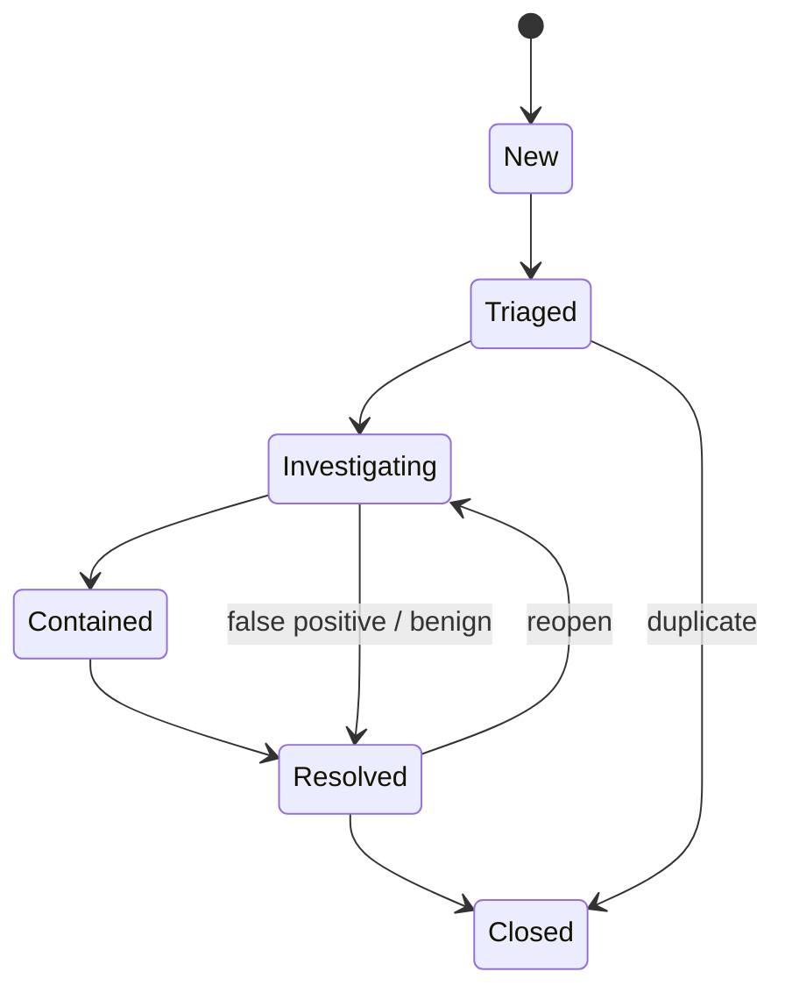
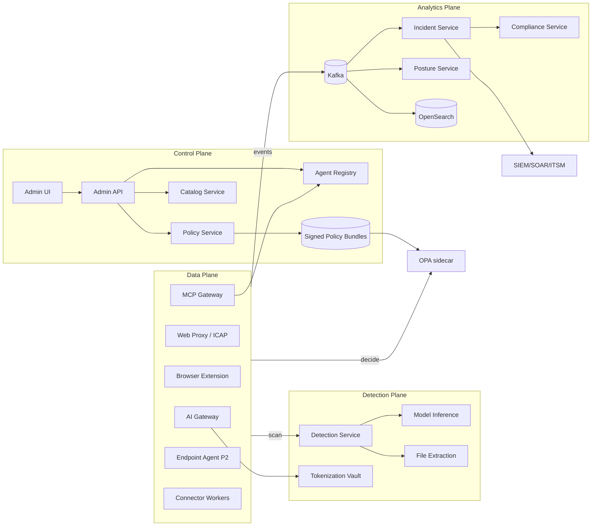
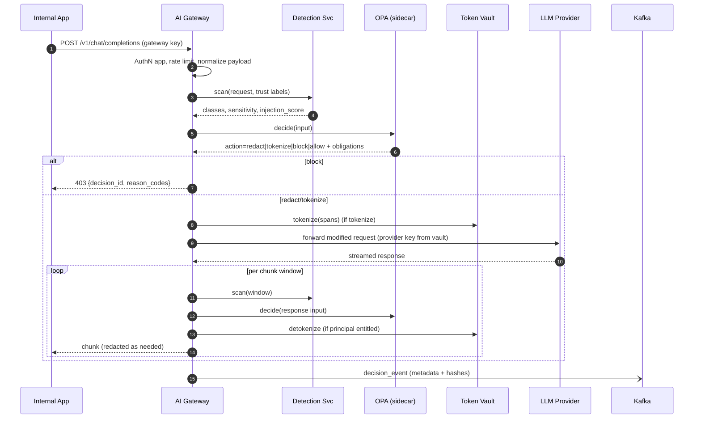
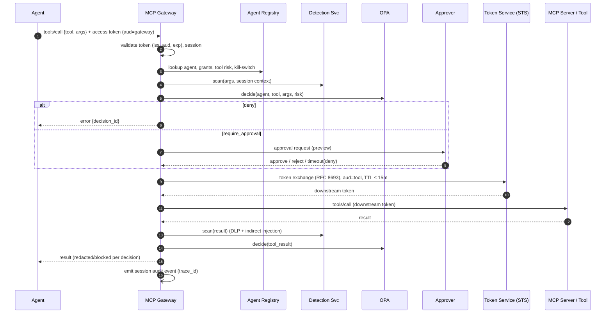
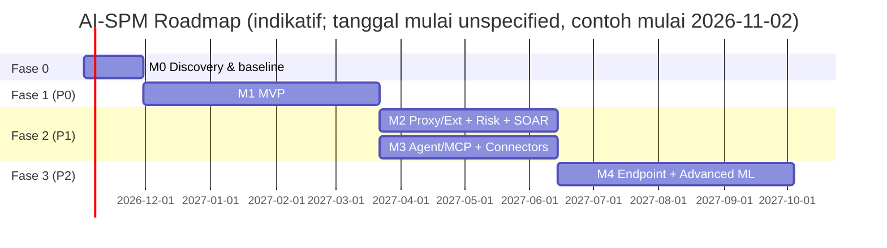

# Spec: Enterprise AI Data Security & AI Security Posture Management (AI-SPM)

Status: draft-1
Tanggal: 2026-10-01
Sumber awal: `docs.md`, `docs2.md` (ringkasan deliverable; `spec.md` asli tidak tersedia, dokumen ini disusun ulang dan diverifikasi ulang ke sumber primer per 2026-10-01)
Owner: `unspecified`

> Konvensi: **MUST / SHOULD / MAY** mengikuti RFC 2119. Nilai yang belum diketahui ditandai `unspecified`. Asumsi ditandai **[ASM-n]**, keputusan ditandai **[DEC-n]**.

---

## 0. Ringkasan Eksekutif

Platform ini mengontrol perpindahan data sensitif ke, dari, dan melalui AI (aplikasi GenAI publik, aplikasi AI internal, dan AI agent). Semua jalur (prompt, file upload, response, tool call agent, data-at-rest yang dikonsumsi AI) diperlakukan sebagai kanal data yang harus **ditemukan, diklasifikasi, dinilai risikonya, dan dikenai kebijakan**.

Keputusan arsitektur utama **[DEC-1]**: *hybrid enforcement architecture*. Tidak ada satu titik kontrol yang cukup. Semua titik enforcement memanggil satu **Detection Plane** dan satu **Policy Decision Point (OPA)**, lalu menulis ke satu **Event + Incident Pipeline**.

```text
Users / Browsers ───────► Inline Web Proxy / Browser Ext ─┐
Internal AI Apps ───────► AI API Gateway (P0) ────────────┤
AI Agents ──────────────► Agent / MCP Gateway (P1) ───────┤
Managed Endpoints ──────► Endpoint Agent (P2) ────────────┼─► Detection Plane ─► Policy Engine (OPA)
Cloud / SaaS ───────────► API Connectors (P0/P1) ─────────┘      (classify,          │
                                                                  prompt security,   ▼
                                                                  risk score)   allow | warn | redact |
                                                                                tokenize | block |
                                                                                quarantine | approval
                                                                                     │
                                                                                     ▼
                                                        Event + Incident Pipeline ─► Posture / Investigation / Compliance
```

Prioritas enforcement:
- **AI Gateway: P0.** Enforcement paling deterministik untuk app-to-LLM.
- **Web proxy + SaaS connectors: P0/P1.** Menangani shadow AI dan posture.
- **Agent/MCP Gateway: P1.** Agent tidak boleh memakai privilege dan tool tanpa governance.
- **Endpoint agent: P2.** Biaya build, deploy, kompatibilitas OS, dan maintenance paling tinggi.

---

## 1. Product Definition

### 1.1 Vision
Organisasi dapat mengadopsi AI (sanctioned AI, internal LLM apps, autonomous agents) tanpa kehilangan kendali atas data sensitif. Setiap interaksi AI juga harus dapat dibuktikan ke regulator dan auditor.

### 1.2 Problem Statement
1. **Shadow AI.** Karyawan memakai layanan GenAI publik dan akun pribadi tanpa visibilitas IT. Data nasabah, kode, dan dokumen internal keluar lewat prompt dan upload.
2. **Kontrol DLP yang ada buta konteks AI.** DLP klasik tidak memahami prompt, response streaming, embedding/RAG, maupun tool call agent.
3. **Serangan spesifik LLM.** Contohnya direct/indirect prompt injection, jailbreak, system prompt leakage, dan excessive agency. Regex atau keyword filtering saja tidak memadai: serangan bisa di-encode, multibahasa, atau berupa adversarial suffix yang dioptimasi (Zou et al. 2023).
4. **Oversharing data-at-rest.** Copilot/RAG mewarisi ACL yang terlalu longgar, sehingga AI bisa "menemukan" data yang secara teknis bisa diakses tetapi tidak seharusnya.
5. **Agent autonomy.** Agent memegang kredensial berumur panjang, mengakses tool melalui MCP/API, dan bertindak tanpa jejak audit atau persetujuan manusia.
6. **Kewajiban regulasi.** UU PDP (notifikasi 3×24 jam), POJK 11/2022 (tata kelola TI bank dan lokasi data), Panduan Tata Kelola AI Perbankan OJK 2025, dan EU AI Act (jika relevan).

### 1.3 Principles
- **P1 Data-centric.** Kebijakan melekat pada klasifikasi data dan konteks, bukan hanya pada domain atau aplikasi.
- **P2 Decision ≠ enforcement.** Semua PEP memanggil PDP yang sama, sehingga satu kebijakan berlaku di semua kanal.
- **P3 Defense-in-depth.** Deterministik (regex, checksum), statistik (ML), dan arsitektural (least privilege, HITL, pemisahan instruksi dan data) dipakai bersama. Tidak ada satu detektor sebagai single point of trust.
- **P4 Privacy by default.** Raw content tidak disimpan by default. Yang disimpan hanya metadata, hash, dan snippet yang sudah di-redact.
- **P5 Explainable decisions.** Setiap keputusan membawa `reason_codes`, versi kebijakan, dan versi model.
- **P6 Versioned everything.** Kebijakan, model detektor, dan framework mapping berversi. Contoh: NIST AI RMF sedang direvisi, jadi mapping tidak boleh di-hard-code.
- **P7 Fail mode eksplisit.** Setiap PEP punya konfigurasi `fail_open | fail_closed` per kebijakan (lihat §13.3).

### 1.4 Non-Goals (v1)
- Tidak membangun LLM/foundation model sendiri.
- Tidak menggantikan SIEM/SOAR/ITSM; platform ini hanya berintegrasi.
- Tidak melakukan model red-teaming penuh atau model scanning (supply chain model). Kandidat P2+ atau integrasi pihak ketiga.
- Tidak mengontrol konten tanpa jalur teknis. Contoh: foto layar dengan HP pribadi.
- Tidak mengklaim "mencegah 100% prompt injection". Target yang realistis adalah menurunkan attack success rate dan membatasi blast radius.
- Tidak mencakup bias/fairness model kredit. Itu ranah model risk management, bukan platform ini.

### 1.5 Success Metrics
| Metrik | Target 6 bulan pasca-GA | Catatan |
|---|---|---|
| Coverage AI traffic yang terlihat (discovered/total egress AI) | ≥ 95% untuk traffic via proxy | Baseline diukur di fase 0 |
| Shadow AI apps teridentifikasi & diberi status sanctioned | ≥ 90% dari top-100 by usage | |
| Precision detektor data sensitif P0 (PII ID, PCI, credentials) | ≥ 0,95 | Pada eval set internal |
| Recall detektor P0 | ≥ 0,90 | |
| FPR prompt-injection classifier pada traffic benign | ≤ 1% | Mencegah alert fatigue |
| Attack success rate (AgentDojo-style suite internal) dengan gateway aktif | turun ≥ 70% vs baseline | |
| Inline latency tambahan p95 (text ≤ 8K token) | ≤ 80 ms | §13 |
| MTTD insiden kritis | ≤ 5 menit | |
| Waktu penyusunan laporan breach (bahan notifikasi UU PDP) | ≤ 24 jam | Batas legal 3×24 jam |
| Agent aktif tanpa owner & tanpa policy | 0 | |

---

## 2. Users & Personas

| Persona | Kebutuhan utama | Hak akses default |
|---|---|---|
| **CISO** | Posture trend, risiko top, bukti ke direksi/regulator | Read dashboard, report |
| **SOC Analyst** | Triage alert, investigasi, containment cepat | Incidents RW, evidence read (redacted) |
| **Security Admin** | Konfigurasi PEP, connector, integrasi | Config RW |
| **DLP Analyst** | Tuning classifier & policy, simulasi, exception | Policy RW (butuh approval publish) |
| **Compliance / DPO** | Mapping kontrol, bukti audit, breach report UU PDP | Compliance RW, evidence unmask (dengan justifikasi) |
| **AI Engineer / App Owner** | Integrasi SDK/gateway, key management, false-positive feedback | App-scoped read, feedback |
| **Agent Owner** | Registrasi agent, scope tool, approval HITL | Agent-scoped RW |
| **Auditor (internal/eksternal)** | Jejak audit tak termodifikasi, riwayat kontrol | Read-only, time-boxed |
| **End User (karyawan)** | Tahu kenapa diblokir, bisa minta pengecualian | Self-service coaching & request |

---

## 3. Scope & MVP

### 3.1 Prioritas
**P0 (MVP, Fase 1):**
- AI API Gateway (OpenAI-compatible + Anthropic + Azure OpenAI + Gemini + self-hosted) dengan inspeksi prompt dan response.
- Detection: regex + checksum + secret detection + NER PII Indonesia + prompt-injection classifier v1.
- Policy engine (OPA): allow, warn, redact, block. Tersedia versioning, simulasi, dan rollback.
- AI app catalog + shadow AI discovery dari log proxy/SWG yang sudah ada (ingest log, bukan inline).
- Event pipeline, incident management dasar, dashboard posture.
- RBAC, SSO (OIDC/SAML), audit log dengan hash chain.
- Integrasi SIEM (syslog/CEF + HTTP).

**P1 (Fase 2):**
- Inline web proxy / browser extension untuk GenAI publik (prompt, upload, paste).
- Agent/MCP Gateway: agent identity, tool allow-list, short-lived credential, HITL approval, kill switch.
- SaaS/data connectors (M365, Google Workspace, S3/GCS/Blob, file share): data-at-rest scan, ACL/oversharing analysis.
- Aksi tambahan: tokenize, quarantine, approval, remediation (hapus/ubah share link).
- Risk scoring penuh + correlation/dedup incident, SOAR/ITSM integration.
- Compliance module: evidence mapping + report.

**P2 (Fase 3):**
- Endpoint agent (Windows/macOS): clipboard, file-to-AI desktop app, AI agent lokal.
- Embedding similarity untuk IP/dokumen rahasia (exact/near-duplicate fingerprint).
- Custom classifier training per tenant, active learning.
- Agent behavior analytics (anomali urutan tool call).
- Multi-region / multi-tenant SaaS.

### 3.2 Definition of Done (per fitur)
1. Requirement FR terkait lulus acceptance test otomatis.
2. Unit coverage ≥ 80% pada modul logika keputusan (detection, policy, risk).
3. Target latency/throughput §13 terpenuhi pada load test.
4. Threat model (STRIDE + OWASP LLM/ASI) terdokumentasi dan temuan high sudah ditutup.
5. Metrics, traces, dan log terpasang (§12.3). Runbook tersedia.
6. Tidak ada raw content di log/telemetry (dicek lewat test otomatis).
7. Dokumentasi API (OpenAPI) dan admin guide diperbarui.

---

## 4. Functional Requirements

### 4.1 AI Discovery & App Catalog (FR-DISC)
- **FR-DISC-1** Sistem MUST memelihara katalog AI app: `vendor, app, domains[], api_endpoints[], category (chat, code, image, agent, embedding, meeting, plugin/extension), data_retention_policy, trains_on_customer_data, hosting_region, ojk_approval_ref, certifications, risk_tier`.
- **FR-DISC-2** Fingerprinting MUST mendukung:
  - domain/SNI
  - URL path pattern
  - API signature (misalnya `POST /v1/chat/completions`, `POST /v1/messages`, `:generateContent`)
  - header khas (`anthropic-version`, `openai-organization`)
  - user-agent SDK
  - bentuk payload JSON (`messages[]`, `model`, `stream`)
- **FR-DISC-3** Setiap deteksi app memiliki `confidence` 0–1: `confidence = 1 − Π(1 − c_i)` atas sinyal independen i. Bobot awal: domain katalog = 0,9, API signature = 0,8, payload shape = 0,6, UA SDK = 0,5. App dengan confidence < 0,6 masuk antrean review.
- **FR-DISC-4** Status sanction: `sanctioned | tolerated | unsanctioned | blocked | under_review`, dengan owner, alasan, dan tanggal review ulang.
- **FR-DISC-5** Katalog MUST dapat di-update tanpa redeploy (feed berversi + override lokal).

### 4.2 Shadow AI (FR-SHADOW)
Definisi kerja: aplikasi AI atau standalone agent yang dipakai tanpa visibilitas atau persetujuan IT.
- **FR-SHADOW-1** Discovery dari: log SWG/proxy/firewall/DNS (P0, batch ingest), inline proxy (P1), browser extension (P1), endpoint (P2), OAuth grant di M365/Google (P1, aplikasi AI yang diberi consent oleh user).
- **FR-SHADOW-2** Konteks tiap sesi MUST mencakup:
  - `account_context`: `corporate | personal | unknown`. Contoh sinyal: tenant header, domain login, SSO assertion.
  - `device_context`: `managed | unmanaged | unknown`.
  - `network_context`: `office | vpn | remote`.
- **FR-SHADOW-3** Faktor risiko per app:
  - apakah data dipakai training
  - retensi
  - lokasi hosting (relevan untuk POJK 11 dan transfer lintas batas UU PDP Pasal 56)
  - SSO/SCIM support
  - sertifikasi
  - riwayat insiden
  - volume data sensitif yang terkirim
- **FR-SHADOW-4** Laporan shadow AI: top apps, top users/unit, volume data sensitif per app, tren mingguan, dan rekomendasi (sanction, block, atau alihkan ke alternatif sanctioned).
- **FR-SHADOW-5** Coaching: saat user mengakses app `unsanctioned`, PEP MAY menampilkan halaman peringatan dengan alternatif sanctioned dan tombol justifikasi (tercatat).

### 4.3 Data Discovery (FR-DATA)
- **FR-DATA-1** **Connector SDK** dengan kontrak: `list_containers()`, `list_items(cursor, since)`, `get_item(id, range)`, `get_acl(id)`, `apply_remediation(id, action)`. Connector berjalan sebagai worker stateless. Cursor dan checkpoint disimpan di Postgres.
- **FR-DATA-2** Incremental scan berbasis change feed (M365 delta query, Drive changes API, S3 event notification). Full scan hanya untuk bootstrap atau rescan terjadwal.
- **FR-DATA-3** Sampling adaptif: kontainer besar di-sample dulu (misalnya 5% atau maks 10.000 item). Scan penuh dilakukan jika densitas sensitif ≥ ambang.
- **FR-DATA-4** Analisis ACL dan oversharing. Yang diflag:
  - link `anyone`/anonymous dan share eksternal
  - grup "Everyone/All company" pada item berlabel sensitif
  - izin yatim (user non-aktif)
  - item sensitif yang terindeks oleh Copilot/RAG
- **FR-DATA-5** Output: `data_asset` + `classification_result` + `exposure_score`. Raw content tidak disimpan.
- **FR-DATA-6** Remediation (P1, butuh approval sesuai policy): cabut link anonim, hapus grup luas, terapkan label sensitivitas, pindahkan ke quarantine.

### 4.4 Classification (FR-CLS)
- **FR-CLS-1** Taksonomi bawaan (berversi, dapat diperluas tenant):

| Kategori | Contoh detektor | Metode |
|---|---|---|
| **PII-ID** | NIK (16 digit; kode wilayah + tanggal lahir terenkode, perempuan +40), No. KK, NPWP (15/16 digit), No. Paspor, No. HP `+62/08`, alamat, nama | regex + validasi struktur + NER |
| **Financial / Perbankan** | nomor rekening (per format bank), CIF, saldo, data kredit/SLIK | regex + kamus + konteks + NER |
| **PCI** | PAN (Luhn + BIN range), CVV (hanya dengan konteks), expiry | regex + checksum |
| **PHI** | diagnosis, ICD-10, no. BPJS Kesehatan | kamus + NER |
| **Credentials / Secrets** | API key (pola vendor), private key PEM, JWT, connection string, password dalam konteks | regex vendor + entropy + validasi format |
| **Source Code / IP** | kode sumber, nama repo internal, dokumen rahasia terdaftar | language detection + fingerprint (P2: embedding) |
| **Legal / HR** | kontrak, data gaji, penilaian kinerja | classifier dokumen |
| **Custom** | kata kunci proyek, pola ID internal | regex/kamus tenant |

- **FR-CLS-2** Setiap match menghasilkan `{type, confidence, span_offsets, validator_passed, context_score}`. Span tidak disimpan setelah redaction.
- **FR-CLS-3** Sensitivity level per item: `public < internal < confidential < restricted`. Aturan agregasi: level tertinggi dari match yang confidence-nya ≥ ambang kategori. Volume dapat menaikkan level (misalnya ≥ 10 NIK berbeda → `restricted`).
- **FR-CLS-4** Dukungan bahasa: Indonesia dan Inggris (P0). Normalisasi Unicode NFKC, deteksi homoglyph, dan penghapusan zero-width char sebelum deteksi.
- **FR-CLS-5** File: teks, PDF, Office, CSV/XLSX, arsip zip (depth ≤ 3), dan gambar via OCR (P1). Batas ukuran di §13.
- **FR-CLS-6** Label eksternal (Microsoft Purview sensitivity label, header klasifikasi dokumen) MUST dibaca dan dihormati sebagai sinyal.

### 4.5 Prompt Security (FR-PSEC)
Ancaman yang dicakup: OWASP LLM01 Prompt Injection, LLM02 Sensitive Information Disclosure, LLM05 Improper Output Handling, LLM06 Excessive Agency, LLM07 System Prompt Leakage, LLM10 Unbounded Consumption, serta ASI01 Agent Goal Hijack dan ASI06 Memory & Context Poisoning.

- **FR-PSEC-1 Direct injection & jailbreak.** Mencakup pola override instruksi ("ignore previous…"), roleplay/persona (DAN), obfuscation, dan many-shot.
- **FR-PSEC-2 Indirect injection.** Konten tak tepercaya (hasil RAG, web fetch, email, hasil tool, file) MUST ditandai `trust=untrusted` dan diinspeksi terpisah dari instruksi user/system. Deteksi instruksi tersembunyi dilakukan di dokumen, HTML (teks tersembunyi, komentar), dan metadata.
- **FR-PSEC-3 Encoding & multibahasa.** Normalisasi dan decode (base64, hex, URL, ROT13, leetspeak, homoglyph, zero-width, dan tag Unicode U+E0000) sebelum klasifikasi. Classifier dilatih multibahasa, minimal ID dan EN.
- **FR-PSEC-4 Adversarial suffix.** Fitur perplexity/entropi token untuk mendeteksi suffix tidak wajar (gaya GCG).
- **FR-PSEC-5 Prompt exfiltration / system prompt leakage.**
  - Canary token opsional disisipkan di system prompt aplikasi yang terdaftar. Response yang mengandung canary atau fragmen system prompt (n-gram overlap ≥ ambang) diblok atau di-redact.
  - Ada deteksi exfil via markdown image/link ke domain eksternal (``).
- **FR-PSEC-6 Role confusion.** Deteksi upaya menyisipkan penanda peran (`<|system|>`, `### System:`, `</user>`, tag XML/JSON palsu) di konten user atau untrusted.
- **FR-PSEC-7 Output handling.** Response diinspeksi untuk data sensitif, canary, link/URL mencurigakan, dan payload berbahaya (script, SQL, perintah shell) bila response diteruskan ke sistem hilir.
- **FR-PSEC-8 Structural defense (rekomendasi untuk app owner, ditegakkan via gateway bila memungkinkan).**
  - Gateway MAY membungkus konten untrusted dengan delimiter/spotlighting sebelum diteruskan ke model.
  - Dokumentasikan pola "pisahkan instruksi dan data" (StruQ, SecAlign) dan "capability-based control flow" (CaMeL) sebagai panduan arsitektur aplikasi agentic.
- **FR-PSEC-9 Unbounded consumption.** Rate limit dan kuota token per app/user/agent. Blok input yang melebihi batas token kebijakan.
- **FR-PSEC-10** Output detektor: `injection_score ∈ [0,1]`, `attack_type[]`, `evidence_spans` (redacted). Keputusan akhir tetap di policy engine.

### 4.6 DLP Actions (FR-DLP)
| Aksi | Perilaku | Kanal |
|---|---|---|
| `allow` | Teruskan, log metadata | semua |
| `warn` / `coach` | Tampilkan peringatan + alasan; user dapat lanjut dengan justifikasi (tercatat) | proxy, ext, endpoint |
| `redact` | Ganti span dengan `[REDACTED:<TYPE>]` sebelum ke model/user | gateway, proxy, MCP |
| `tokenize` | Ganti dengan token format-preserving yang reversible; detokenisasi di response hanya untuk principal berhak | gateway (P1) |
| `block` | Tolak request/response dengan pesan standar + `decision_id` | semua |
| `quarantine` | File/item dipindah atau dikunci, menunggu review | connectors |
| `require_approval` | Tahan aksi sampai approver menyetujui (timeout → deny) | MCP gateway, connectors |
| `remediate` | Ubah ACL/share link/label | connectors |

- **FR-DLP-1** Redaction MUST mempertahankan validitas struktur request (JSON tetap valid, `messages[]` utuh).
- **FR-DLP-2** Untuk response streaming (SSE), gateway MUST melakukan inspeksi bertahap:
  - buffer sliding window (default 256 token) dengan look-behind untuk entitas yang terpotong antar-chunk
  - aksi `block` di tengah stream memutus stream dan mengirim event penutup yang valid
- **FR-DLP-3** Tokenization vault terpisah (HSM/KMS-backed), TTL token dapat dikonfigurasi, dan setiap detokenisasi tercatat di audit log.

### 4.7 Policy Engine (FR-POL)
- **FR-POL-1** PDP = **OPA** (Rego), sebagai sidecar atau library embedded di tiap PEP. Bundle policy + data didistribusikan dari Policy Service. Bundle ditandatangani dan memakai ETag/long-polling.
- **FR-POL-2** Input kanonik ke PDP:
```json
{
  "channel": "ai_gateway|web_proxy|browser_ext|endpoint|mcp_gateway|connector",
  "direction": "request|response|tool_call|tool_result|at_rest",
  "principal": {"type": "user|agent|service", "id": "...", "groups": [], "risk": 0.2, "device": "managed", "account_context": "corporate"},
  "destination": {"app_id": "...", "sanction": "sanctioned", "region": "ID", "trains_on_data": false},
  "content": {"sensitivity": "restricted", "classes": [{"type": "PII_ID.NIK", "count": 12, "confidence": 0.98}], "injection_score": 0.07, "tokens": 1830},
  "agent": {"agent_id": "...", "tool": "payments.transfer", "tool_risk": "high", "hitl_available": true},
  "risk_score": 72
}
```
- **FR-POL-3** Output PDP: `{action, obligations[] (e.g. redact_types, notify, require_justification), reason_codes[], policy_id, policy_version}`.
- **FR-POL-4** Precedence **[DEC-2]**: `block > quarantine > require_approval > tokenize > redact > warn > allow`. Jika beberapa rule match, aksi paling ketat menang dan obligations digabung.
- **FR-POL-5 Lifecycle.**
  - Alur: `draft → simulated → pending_approval → active → retired`.
  - Publish butuh 4-eyes (author ≠ approver).
  - Rollback ke versi sebelumnya ≤ 1 klik, dengan propagasi sesuai target §13.
- **FR-POL-6 Simulation.** Jalankan policy baru terhadap event 7–30 hari terakhir (metadata tersimpan) dan sampel test corpus. Tampilkan diff keputusan (berapa allow → block, dan seterusnya) sebelum publish. Mode `monitor-only` per rule juga tersedia.
- **FR-POL-7 Exceptions.** Scope (user/grup/app/agent), alasan, approver, dan **wajib punya tanggal kedaluwarsa** (maksimal 90 hari default). Notifikasi dikirim 7 hari sebelum kedaluwarsa.
- **FR-POL-8** Policy templates bawaan: PII-ID ke unsanctioned AI = block; credentials ke AI mana pun = block; PCI PAN = redact; restricted ke sanctioned AI = redact + log; injection_score ≥ 0,9 = block.
- **FR-POL-9** Decision log OPA MUST mengaktifkan masking field sensitif sebelum dikirim.

### 4.8 Agent Governance (FR-AGT)
Ancaman: OWASP ASI01–ASI10 (goal hijack, tool misuse, identity & privilege abuse, agentic supply chain, unexpected code execution, memory poisoning, insecure inter-agent comms, cascading failures, human-agent trust exploitation, rogue agents) dan LLM06 Excessive Agency.

- **FR-AGT-1 Agent registry.**
  - Isi: `agent_id, owner, purpose, model, framework, environment, tools[] (with scopes), data_scopes[], risk_tier, status`.
  - Agent tanpa owner MUST berstatus `quarantined`.
  - Agent yang ditemukan tapi tidak terdaftar (shadow agent via MCP traffic, OAuth grant, atau endpoint di P2) masuk antrean review.
- **FR-AGT-2 Agent identity.** Setiap agent memakai workload identity (SPIFFE/SVID, OIDC client, atau managed identity cloud). Kredensial user bersama dilarang.
- **FR-AGT-3 MCP Gateway.** Proxy MCP (Streamable HTTP; STDIO via local wrapper di P2) yang:
  - memverifikasi token sesuai spesifikasi otorisasi MCP 2026-07-28: OAuth 2.1, RFC 9728 Protected Resource Metadata, RFC 8707 `resource` indicator, dan validasi audience
  - **tidak melakukan token passthrough** (dilarang eksplisit oleh spec MCP); gateway menukar token (token exchange, RFC 8693) ke kredensial downstream berumur pendek
  - memperoleh consent per-client untuk mencegah confused deputy
  - menginspeksi **tool-call arguments, tool results, dan resource reads** dengan DLP + prompt-security
  - memindai tool description/metadata saat registrasi dan saat berubah (**tool poisoning**, rug-pull). Hash deskripsi di-pin; perubahan memicu re-approval.
- **FR-AGT-4 Least privilege.** Allow-list tool per agent, scope parameter (misalnya `amount ≤ X`, `recipient ∈ allow-list`), rate limit per tool, dan batas kedalaman rantai agent-ke-agent.
- **FR-AGT-5 Short-lived credentials.** TTL default ≤ 15 menit. Refresh token dirotasi. Secret disimpan di vault, tidak pernah masuk konteks model.
- **FR-AGT-6 HITL approval.** Tool dengan `tool_risk=high` (transfer dana, hapus data, kirim email eksternal, ubah akses) MUST melalui approval. Approver melihat preview aksi dan parameter lengkap (redacted sesuai hak). Timeout berakhir `deny`.
- **FR-AGT-7 Kill switch.** Per agent, per tool, per app, dan global. Efek ≤ 10 detik: token dicabut, sesi diputus, dan policy `block` dipush.
- **FR-AGT-8 Session audit.** Urutan lengkap `prompt → plan → tool_call → result → response` dengan korelasi `trace_id`, disimpan sebagai metadata + hash. Konten tersimpan hanya jika kebijakan forensik mengizinkan.
- **FR-AGT-9 Memory/context poisoning.** Tulis ke memory jangka panjang agent atau vector store diinspeksi dengan detektor injection. Sumber tulis dicatat (provenance).

### 4.9 Risk Scoring (FR-RISK)
- **FR-RISK-1** Skor event 0–100:

```
base = 100 × Σ w_i · f_i        (f_i ∈ [0,1], Σ w_i = 1)

f_sens   sensitivitas konten (public 0, internal .3, confidential .6, restricted 1) × faktor volume   w=0.30
f_dest   risiko tujuan (sanctioned 0, tolerated .4, unsanctioned .8, blocked/personal account 1)    w=0.20
f_attack max(injection_score, jailbreak_score, exfil_score)                                          w=0.15
f_agency risiko aksi (read .1, write .5, external send .8, financial/irreversible 1)                 w=0.15
f_volume log-scaled jumlah entitas/bytes vs baseline principal                                       w=0.10
f_ident  konteks principal (unmanaged device, personal acct, user risk dari IdP/UEBA)               w=0.10

score = min(100, round(base))
```
- **FR-RISK-2** Critical overrides (skor langsung ditetapkan):
  - credential/secret valid → tujuan non-sanctioned: **100**
  - injection terdeteksi (≥ 0,8) **dan** diikuti tool call `high` pada sesi sama: **100**
  - PAN valid (Luhn + BIN) atau ≥ 10 NIK valid → personal account / unsanctioned: **≥ 90**
  - agent tidak terdaftar memanggil tool `high`: **≥ 90**
- **FR-RISK-3** Bobot dan override berversi dan dapat disimulasikan seperti policy. Kalibrasi ulang tiap kuartal dengan label triage SOC.
- **FR-RISK-4** Skor agregat per user, app, agent, dan data asset memakai rata-rata berbobot waktu (half-life 14 hari) untuk posture dashboard.

### 4.10 Incident Management (FR-INC)
- **FR-INC-1 Correlation & dedup.** Event dengan `(principal, destination, class, policy_id)` sama dalam window 30 menit digabung ke satu incident. Event dengan `trace_id`/session agent sama dikorelasikan ke satu incident rantai.
- **FR-INC-2 Severity.** `critical ≥ 90`, `high 70–89`, `medium 40–69`, `low < 40`. Dapat dinaikkan manual.
- **FR-INC-3 State machine.**

- **FR-INC-4 Evidence.**
  - Metadata, keputusan, reason codes, snippet redacted, dan hash konten.
  - Raw content hanya jika `forensic_capture` aktif untuk policy tersebut. Raw content dienkripsi per-incident, akses unmask butuh justifikasi, dan setiap akses tercatat.
- **FR-INC-5 Containment actions.** Block user ke app, cabut token agent, kill switch, cabut share link, paksa reset kredensial (via integrasi IAM/secrets), dan buka tiket ITSM.
- **FR-INC-6 Breach workflow (UU PDP).** Incident yang melibatkan data pribadi terkonfirmasi keluar MUST memulai timer 3×24 jam. Sistem menghasilkan draft laporan berisi data pribadi yang terungkap, kapan dan bagaimana, upaya penanganan dan pemulihan (Pasal 46), serta daftar subjek terdampak (jika dapat ditentukan).
- **FR-INC-7 SLA default.** Critical: acknowledge ≤ 15 menit. High: ≤ 1 jam. Metrik MTTD/MTTR tersedia.

### 4.11 Compliance & Posture (FR-COMP)
- **FR-COMP-1 Framework library berversi.** OWASP LLM Top 10 2025, OWASP Agentic Top 10 2026, NIST AI RMF 1.0 + AI 600-1, ISO/IEC 42001:2023 Annex A, UU PDP 27/2022 (+ PP 33/2026), POJK 11/POJK.03/2022, Panduan Tata Kelola AI Perbankan OJK 2025, EU AI Act (opsional). Mapping awal di §14.
- **FR-COMP-2** Setiap kontrol platform (`control_id`) dipetakan ke ≥ 1 requirement framework. Bukti otomatis diambil dari konfigurasi, policy aktif, statistik enforcement, dan hasil test.
- **FR-COMP-3 Control history.** Status kontrol per waktu dapat diekspor untuk periode audit.
- **FR-COMP-4 Audit integrity.** Audit log append-only. Setiap entri memuat `hash = SHA-256(prev_hash ‖ canonical_json(entry))`. Anchor harian ditandatangani KMS dan disimpan di object storage WORM (object lock).
- **FR-COMP-5 Posture dashboard.**
  - Skor posture per domain: discovery, data, prompt, agent, policy hygiene.
  - Tren 90 hari, top risks, dan exception yang akan kedaluwarsa.
  - AI inventory (register AI sesuai kebutuhan panduan OJK dan ISO 42001).

---

## 5. Architecture

### 5.1 Planes
| Plane | Tanggung jawab | Komponen |
|---|---|---|
| **Control Plane** | Konfigurasi, katalog, policy authoring, registry agent, tenant, RBAC | Admin UI, Admin API, Policy Service, Catalog Service, Agent Registry, Identity Service |
| **Data Plane (PEP)** | Intersepsi & enforcement inline | AI Gateway, Web Proxy/ICAP, Browser Extension, MCP Gateway, Endpoint Agent, Connector Workers |
| **Detection Plane** | Klasifikasi, prompt security, risk scoring (stateless, horizontal scale) | Detection Service (fast path), Model Inference (NER, classifier), File Extraction Service, Tokenization Vault |
| **Analytics Plane** | Event, incident, posture, compliance, search | Event Ingest (Kafka), Incident Service, Posture Service, Compliance Service, Search (OpenSearch) |

### 5.2 Diagram Komponen


### 5.3 Microservices
| Service | Bahasa (rekomendasi) | Storage milik | Scaling | Catatan |
|---|---|---|---|---|
| ai-gateway | Go (atau Envoy + ext_proc) | – (stateless), Redis untuk rate limit | HPA by RPS/latency | Streaming SSE, provider adapters |
| web-proxy-adapter | Go | – | HPA | ICAP/REQMOD-RESPMOD ke SWG yang ada |
| mcp-gateway | Go | Redis (session), Postgres via Agent Registry | HPA | Token exchange, HITL hold |
| detection-svc | Rust/Go (fast path) | – | HPA by CPU | Regex (Hyperscan/RE2), checksum, secrets |
| model-inference | Python (Triton/ONNX Runtime) | model registry (object storage) | GPU/CPU pool, HPA | NER, injection classifier |
| file-extract | Go + Apache Tika (sandboxed) | temp object storage (TTL 1 jam) | queue-based workers | Isolasi gVisor/Firecracker |
| tokenization-vault | Go | Postgres (terenkripsi) + KMS | active-passive | FPE (FF1) |
| policy-svc | Go | Postgres | low | Bundle builder, simulasi |
| catalog-svc | Go | Postgres | low | Feed katalog AI |
| agent-registry | Go | Postgres | low | Kill switch publisher |
| connector-workers | Go/Python | Postgres (cursor), object storage | queue workers per connector | Rate-limit aware |
| event-ingest | Kafka + consumers | Kafka, OpenSearch, ClickHouse (opsional) | partisi per tenant | Schema registry |
| incident-svc | Go | Postgres | medium | Correlation, SLA timer |
| posture-svc | Go/Python | Postgres/ClickHouse | batch | Agregasi skor |
| compliance-svc | Go | Postgres, object storage WORM | low | Evidence, audit anchor |
| admin-api / ui | Go / TypeScript (React) | Postgres | low | OIDC/SAML, SCIM |

**[DEC-3]** Mulai dengan **modular monolith untuk control plane** (policy, catalog, registry, incident, compliance dalam satu deployable dengan modul terpisah dan schema Postgres per modul). Pisahkan hanya PEP dan detection karena profil scaling dan latensinya berbeda. Service dipecah saat ada kebutuhan scaling atau tim yang nyata.

### 5.4 Enforcement Points
| PEP | Prioritas | Kanal yang dicover | Kelebihan | Keterbatasan |
|---|---|---|---|---|
| AI API Gateway | P0 | Internal apps → LLM (OpenAI, Anthropic, Azure, Gemini, self-hosted) | Deterministik, prompt & response penuh, key management terpusat | Hanya app yang diarahkan ke gateway |
| Web Proxy / SWG (ICAP) | P1 (log ingest P0) | Browser → GenAI publik | Coverage luas tanpa ubah app | TLS inspection, pinning, HTTP/3/QUIC, websocket |
| Browser Extension | P1 | Prompt/paste/upload di halaman GenAI | Konteks DOM, coaching UX | Hanya browser managed, perlu update seiring perubahan UI vendor |
| MCP / Agent Gateway | P1 | Agent → MCP server / API tools | Tool-call level control, HITL | Agent harus dikonfigurasi lewat gateway; STDIO lokal butuh wrapper |
| SaaS/Cloud API Connectors | P0 (M365 read) / P1 | Data-at-rest, ACL, OAuth grants, audit log vendor (mis. Compliance API) | Posture & remediation | Tidak inline, bergantung pada API vendor |
| Endpoint Agent | P2 | Desktop AI apps, clipboard, agent lokal | Coverage off-network | Biaya build/maintenance tertinggi, kompatibilitas OS |

---

## 6. Data Model (PostgreSQL)

Semua tabel memiliki `tenant_id` + Row-Level Security (RLS). Event volume tinggi disimpan di Kafka → OpenSearch/ClickHouse. Postgres hanya menyimpan entitas dan agregat.

```mermaid
erDiagram
  TENANT ||--o{ PRINCIPAL : has
  TENANT ||--o{ AI_APP : catalogs
  TENANT ||--o{ POLICY : owns
  TENANT ||--o{ AGENT : registers
  TENANT ||--o{ DATA_SOURCE : connects
  PRINCIPAL ||--o{ AGENT : owns
  AI_APP ||--o{ AI_APP_FINGERPRINT : identified_by
  AI_APP ||--o{ APP_USAGE_DAILY : aggregates
  AGENT ||--o{ AGENT_TOOL_GRANT : granted
  TOOL ||--o{ AGENT_TOOL_GRANT : in
  MCP_SERVER ||--o{ TOOL : exposes
  POLICY ||--o{ POLICY_VERSION : versions
  POLICY_VERSION ||--o{ SIMULATION_RUN : tested_by
  POLICY ||--o{ POLICY_EXCEPTION : has
  DATA_SOURCE ||--o{ DATA_ASSET : contains
  DATA_ASSET ||--o{ CLASSIFICATION_RESULT : classified
  DATA_ASSET ||--o{ ACL_ENTRY : shared_via
  DECISION_EVENT }o--|| POLICY_VERSION : evaluated_by
  DECISION_EVENT }o--o| AI_APP : destination
  DECISION_EVENT }o--o| AGENT : actor
  INCIDENT ||--o{ INCIDENT_EVENT : groups
  DECISION_EVENT ||--o{ INCIDENT_EVENT : member
  INCIDENT ||--o{ EVIDENCE : holds
  INCIDENT ||--o{ APPROVAL_REQUEST : may_need
  CONTROL ||--o{ CONTROL_MAPPING : maps
  FRAMEWORK_REQ ||--o{ CONTROL_MAPPING : mapped
  CONTROL ||--o{ CONTROL_STATUS_HISTORY : history
  TENANT ||--o{ AUDIT_LOG : records

  TENANT {
    uuid id PK
    text name
    text region
    jsonb settings
  }
  PRINCIPAL {
    uuid id PK
    uuid tenant_id
    text type
    text external_id
    text email_hash
    jsonb groups
    numeric risk
  }
  AI_APP {
    uuid id PK
    uuid tenant_id
    text vendor
    text name
    text category
    text sanction
    text hosting_region
    text ojk_approval_ref
    bool trains_on_data
    int risk_tier
    date review_at
  }
  AI_APP_FINGERPRINT {
    uuid id PK
    uuid app_id
    text kind
    text pattern
    numeric weight
  }
  APP_USAGE_DAILY {
    uuid app_id
    date day
    int users
    int events
    int sensitive_events
    bigint bytes
  }
  AGENT {
    uuid id PK
    uuid tenant_id
    uuid owner_id
    text name
    text identity_ref
    text risk_tier
    text status
  }
  MCP_SERVER {
    uuid id PK
    uuid tenant_id
    text url
    text status
    text descriptor_hash
  }
  TOOL {
    uuid id PK
    uuid mcp_server_id
    text name
    text risk
    text description_hash
    jsonb schema
  }
  AGENT_TOOL_GRANT {
    uuid agent_id
    uuid tool_id
    jsonb constraints
    bool requires_approval
    timestamptz expires_at
  }
  POLICY {
    uuid id PK
    uuid tenant_id
    text name
    text status
  }
  POLICY_VERSION {
    uuid id PK
    uuid policy_id
    int version
    text rego
    text author
    text approver
    timestamptz published_at
    text bundle_digest
  }
  SIMULATION_RUN {
    uuid id PK
    uuid policy_version_id
    jsonb diff_summary
    timestamptz ran_at
  }
  POLICY_EXCEPTION {
    uuid id PK
    uuid policy_id
    jsonb scope
    text reason
    text approver
    timestamptz expires_at
  }
  DATA_SOURCE {
    uuid id PK
    uuid tenant_id
    text kind
    jsonb config_ref
    text cursor
    timestamptz last_scan
  }
  DATA_ASSET {
    uuid id PK
    uuid source_id
    text external_id
    text path_hash
    text sensitivity
    numeric exposure_score
    timestamptz scanned_at
  }
  CLASSIFICATION_RESULT {
    uuid id PK
    uuid asset_id
    text class
    int count
    numeric confidence
    text model_version
  }
  ACL_ENTRY {
    uuid id PK
    uuid asset_id
    text grantee_kind
    text grantee_ref
    text permission
    bool external
  }
  DECISION_EVENT {
    uuid id PK
    uuid tenant_id
    timestamptz ts
    text channel
    text direction
    uuid principal_id
    uuid app_id
    uuid agent_id
    text action
    int risk_score
    text_array reason_codes
    uuid policy_version_id
    text content_hash
    text trace_id
  }
  INCIDENT {
    uuid id PK
    uuid tenant_id
    text severity
    text state
    text title
    uuid assignee
    timestamptz opened_at
    timestamptz breach_deadline
  }
  INCIDENT_EVENT {
    uuid incident_id
    uuid event_id
  }
  EVIDENCE {
    uuid id PK
    uuid incident_id
    text kind
    text object_ref
    text dek_ref
    text sha256
  }
  APPROVAL_REQUEST {
    uuid id PK
    uuid tenant_id
    text subject_kind
    uuid subject_id
    jsonb preview
    text state
    uuid approver
    timestamptz expires_at
  }
  FRAMEWORK_REQ {
    uuid id PK
    text framework
    text version
    text ref
    text title
  }
  CONTROL {
    uuid id PK
    text code
    text title
    text evidence_query
  }
  CONTROL_MAPPING {
    uuid control_id
    uuid framework_req_id
  }
  CONTROL_STATUS_HISTORY {
    uuid control_id
    timestamptz ts
    text status
    jsonb evidence_summary
  }
  AUDIT_LOG {
    bigint seq PK
    uuid tenant_id
    timestamptz ts
    text actor
    text action
    jsonb target
    text prev_hash
    text hash
  }
```



Catatan:
- `DECISION_EVENT` di Postgres hanya untuk event yang masuk incident atau untuk sampling. Arsip lengkap ada di store analitik (partisi harian, TTL §10.2).
- `email_hash` dan `path_hash` memakai HMAC-SHA256 dengan pepper per tenant (pseudonymization). Mapping ke nilai asli ada di tabel terpisah dengan akses terbatas.

---

## 7. Sequence Diagrams

### 7.1 Prompt Enforcement via AI Gateway


### 7.2 AI Agent Tool Call via MCP Gateway


---

## 8. API Contracts (ringkas; OpenAPI lengkap dibuat pada implementasi)

Base: `/api/v1`. Auth memakai OAuth2 client credentials (service) atau OIDC (user). Semua respons membawa `request_id`. Error mengikuti RFC 9457 (`application/problem+json`).

### 8.1 `POST /scan/text`
```json
// request
{ "content": "string (≤ 256 KB)", "channel": "ai_gateway", "direction": "request",
  "context": { "principal_id": "…", "app_id": "…", "trust": "trusted|untrusted" },
  "evaluate_policy": true }
// response 200
{ "decision_id": "…", "action": "redact",
  "classes": [{"type":"PII_ID.NIK","count":2,"confidence":0.99}],
  "injection": {"score":0.04,"types":[]},
  "risk_score": 64, "reason_codes": ["PII_ID_TO_SANCTIONED_REDACT"],
  "redacted_content": "… [REDACTED:PII_ID.NIK] …",
  "policy_version": "pol-12@v7", "model_versions": {"ner":"ner-id-1.3","inj":"inj-2.0"} }
```

### 8.2 `POST /scan/file`
- Multipart upload (≤ 50 MB) atau `{object_ref}`.
- Mode `sync` jika ≤ 5 MB. File lebih besar mengembalikan `202 {job_id}`, dengan hasil via `GET /scan/jobs/{job_id}` atau webhook.

### 8.3 `POST /policies/{id}/simulate`
```json
{ "version": 8, "window": {"from":"2026-09-01","to":"2026-09-30"}, "include_corpus": true }
// 202 → GET /simulations/{sim_id}
{ "total": 120331, "changed": 842,
  "diff": {"allow→redact": 610, "allow→block": 12, "redact→allow": 220},
  "samples": [{"event_id":"…","old":"allow","new":"block","reason_codes":["…"]}] }
```

### 8.4 App Inventory
- `GET /apps?sanction=unsanctioned&sort=-sensitive_events&limit=50&cursor=…`
- `PATCH /apps/{id}` `{ "sanction": "blocked", "reason": "…", "review_at": "2027-01-01" }` (tercatat di audit log)

### 8.5 Incidents
- `GET /incidents?severity=critical&state=New`
- `POST /incidents/{id}/transition` `{ "to": "Contained", "note": "…" }`
- `POST /incidents/{id}/actions` `{ "type": "revoke_agent_tokens", "target": "agent-123" }`
- `GET /incidents/{id}/evidence/{eid}?unmask=true` (butuh permission `evidence.unmask` + `justification`)

### 8.6 Agent Authorization (dipakai MCP Gateway/SDK)
```json
POST /agents/{agent_id}/authorize
{ "tool": "payments.transfer", "args_digest": "sha256:…", "args_summary": {"amount": 25000000, "currency": "IDR"},
  "session_id": "…", "trace_id": "…" }
// 200
{ "decision": "require_approval", "approval_id": "apr-9", "expires_at": "…", "reason_codes": ["HIGH_RISK_TOOL"] }
```
- `POST /agents/{id}/kill` → `{ "scope": "agent|tool|global", "reason": "…" }`

### 8.7 Gateway (data plane)
Kompatibel dengan API provider:
- `/v1/chat/completions`, `/v1/responses`, `/v1/embeddings` (OpenAI-compatible)
- `/v1/messages` (Anthropic)
- passthrough Gemini `:generateContent`

Header tambahan: `X-Wantimpres26-Decision-Id`, `X-Wantimpres26-Action`. Block memakai HTTP 403 dengan body format error provider agar SDK klien tidak crash.

---

## 9. Detection / ML Pipeline

### 9.1 Pipeline (fast path → slow path)
```
normalize (NFKC, zero-width strip, homoglyph map, decode layers ≤ 3)
  → L1 deterministic: RE2/Hyperscan regex, checksum (Luhn, NIK struktur, NPWP), secret patterns + entropy
  → L2 ML: NER PII/entitas (ID+EN), prompt-injection/jailbreak classifier, perplexity feature
  → L3 (async/opsional): document classifier, embedding similarity ke corpus rahasia (P2), OCR
  → aggregate → sensitivity, injection_score, evidence
```
- Budget latensi inline: L1 ≤ 10 ms, L2 ≤ 50 ms p95 (CPU ONNX atau GPU batch). L3 tidak berada di jalur inline, kecuali file upload yang memang async.
- **Short-circuit**: jika L1 menghasilkan kondisi `block` yang pasti (misalnya private key), L2 dilewati.
- **[DEC-4] Tidak ada LLM eksternal di jalur deteksi.** Semua model deteksi self-hosted, karena konten sensitif tidak boleh dikirim ke pihak ketiga untuk diperiksa (POJK 11 lokasi data dan UU PDP). LLM-as-judge MAY dipakai offline untuk labeling dengan model yang juga self-hosted.

### 9.2 Model
| Model | Arsitektur awal | Output |
|---|---|---|
| NER PII (ID/EN) | Transformer encoder kecil multibahasa (mis. keluarga XLM-R/mDeBERTa-small), distilasi → ONNX int8 | span + label |
| Injection/jailbreak classifier | Encoder classifier biner + multi-label jenis serangan, fitur tambahan perplexity | score + types |
| Document classifier (P1) | Encoder + head per kategori (legal, HR, finance, code) | label + confidence |
| Similarity (P2) | Winnowing fingerprint shingle kata, ber-HMAC (excerpt verbatim ≥ 8 kata dijamin terdeteksi, tiket 37) + sentence embedding untuk parafrase (menunggu model self-hosted) | dokumen terdaftar + shared/containment |

### 9.3 Training Data
- **Corpus.**
  - Publik: dataset prompt injection/jailbreak berlisensi terbuka, benign prompt enterprise-like, dan kode.
  - Sintetis: generator PII Indonesia. NIK/NPWP/rekening dibuat valid secara struktur tetapi fiktif, dan disisipkan ke template dokumen bank (surat, formulir, chat CS).
  - Adversarial: variasi encoding, multibahasa (ID, EN, campuran, bahasa daerah bila tersedia), GCG-style suffix, dan indirect injection dalam HTML/PDF/email. Termasuk skenario AgentDojo (terdapat environment e-banking).
- **Customer data isolation.** Data nasabah/tenant **tidak pernah** dipakai melatih model global. Fine-tune per tenant (P2) hanya dengan opt-in eksplisit, berjalan di tenant boundary, dan hasil model tidak keluar tenant.
- **Labeling.**
  - Guideline tertulis per kelas.
  - Tiap sampel eval dilabel ganda dengan target inter-annotator agreement κ ≥ 0,8; konflik diputus oleh adjudicator.
  - Label feedback dari triage SOC (true/false positive) masuk antrean active learning setelah di-redact.
- **Provenance.** Setiap dataset tercatat (sumber, lisensi, versi, hash). Model card per rilis.

### 9.4 Evaluation
- **Metrik per kelas.**
  - Precision, recall, F1, PR-AUC, dan FPR pada traffic benign.
  - Kalibrasi: Expected Calibration Error ≤ 0,05, supaya ambang di policy bermakna.
- **Metrik serangan.**
  - Attack Success Rate (ASR) dengan dan tanpa gateway.
  - Utility under attack: task agent tetap berhasil, mengikuti metrik AgentDojo.
  - Detection rate per teknik: encoding, multilingual, indirect, suffix.
- **Gate rilis model.** Tidak boleh regresi > 1 poin F1 pada kelas P0. FPR benign tidak boleh naik > 0,2 poin. ASR suite internal tidak boleh naik. Latensi p95 tetap dalam budget.
- **Eval set** dibekukan per kuartal (holdout) plus set "fresh attacks" bulanan dari red team dan threat intel.
- Rollout model: shadow mode (skor dicatat, tidak dipakai policy) → canary 5% → 100%.

---

## 10. Security & Privacy

### 10.1 Security
- **Encryption.** TLS 1.3 untuk semua koneksi (mTLS antar-service via mesh). At rest: AES-256. Envelope encryption dengan KMS/HSM di Indonesia; DEK per tenant, dan per incident untuk evidence.
- **Tenant isolation.** Postgres RLS + `tenant_id` di setiap query (diuji otomatis), topic/partisi Kafka per tenant atau kunci partisi tenant, index OpenSearch per tenant untuk tier tinggi.
- **AuthN.** SSO OIDC/SAML dengan MFA wajib untuk admin. SCIM 2.0 untuk provisioning. Service identity memakai SPIFFE/mTLS.
- **AuthZ.**
  - RBAC (§2) + ABAC: atribut unit bisnis, region, dan sensitivitas.
  - Permission sensitif (`evidence.unmask`, `policy.publish`, `agent.kill.global`) butuh re-auth + justifikasi.
  - Break-glass account diaudit.
- **Secrets.** Provider API key dan token downstream di vault. Tidak pernah dikirim ke klien atau masuk konteks model.
- **Supply chain.** Lihat §12.2.
- **Hardening PEP.** File extraction di sandbox (gVisor/Firecracker), batas dekompresi (zip bomb), timeout parser, dan fuzzing parser.
- **Self-protection.** Admin UI dan API diuji terhadap OWASP ASVS L2. Katalog feed dan policy bundle ditandatangani dan diverifikasi sebelum dimuat.

### 10.2 Privacy
- **Default tanpa raw content.** Event hanya menyimpan metadata, klasifikasi, hash (HMAC per tenant), dan snippet ter-redact ≤ 200 karakter.
- **Forensic capture** hanya per policy eksplisit, terenkripsi, TTL default 30 hari, dan akses unmask tercatat.
- **Retention default** (dapat dikonfigurasi, `unspecified` final menunggu kebijakan retensi bank):

| Data | TTL |
|---|---|
| Decision event (metadata) | 400 hari (analitik 90 hari hot) |
| Evidence raw | 30 hari (atau sampai incident closed + 30 hari) |
| Audit log | ≥ 5 tahun (WORM) |
| Temp file extraction | 1 jam |
| Token vault mapping | per kebijakan tokenization |

- **Pseudonymization.** Identitas user di analitik memakai HMAC. Re-identifikasi hanya untuk peran berhak.
- **Model-training controls.** Konten tenant tidak dipakai melatih model global (§9.3). Kontrak dengan provider LLM yang diteruskan gateway MUST mengatur *no training on customer data* dan retensi. Nilai ini dicatat di katalog (`trains_on_data`).
- **Minimisasi data untuk monitoring karyawan.** Transparansi ke karyawan melalui kebijakan internal. DPIA (UU PDP Ps. 34: pemantauan sistematis skala besar) wajib ditandatangani DPO, Legal, HR, dan CISO sebelum inline proxy atau extension (tiket 22, 23) dirilis ke produksi: `docs/dpia-pemantauan-ai-karyawan.md` (tiket 35).
- **Data residency [ASM-1, dikonfirmasi ADR-0001].** Semua komponen yang memproses konten di-deploy di DC dan DRC bank di Indonesia (POJK 11/2022 mensyaratkan data center dan DRC bank di Indonesia kecuali ada persetujuan OJK). Platform tidak punya komponen, penyimpanan, atau telemetri konten offshore; feed eksternal hanya *pull* masuk dan bertanda tangan. Prompt ke LLM offshore diatur lewat katalog (`hosting_region`, `ojk_approval_ref`) dan default policy per sensitivity: `restricted` → block, `confidential` → redact/tokenize, `internal`/`public` → allow hanya untuk app `sanctioned`. Detail: `docs/adr/0001-hosting-residency-build-scope.md`.

---

## 11. Integrations
| Kategori | Target (awal) | Arah | Prioritas |
|---|---|---|---|
| IAM / IdP | Entra ID, Okta, Keycloak; SCIM | in (user, grup, risk) | P0 |
| AI providers | OpenAI, Azure OpenAI, Anthropic, Google Gemini/Vertex, AWS Bedrock, self-hosted (vLLM/Ollama) | proxy | P0 |
| SWG / Proxy / Firewall log | Zscaler, Netskope, Palo Alto, Squid, Fortinet (syslog/log file) | in | P0 |
| SWG inline (ICAP) | SWG yang mendukung ICAP | in/out | P1 |
| M365 | Graph API (SharePoint/OneDrive/Teams), Purview labels, audit log, Copilot interactions | in/remediate | P1 |
| Google Workspace | Drive API, Admin SDK, OAuth token audit | in/remediate | P1 |
| Cloud storage | S3, GCS, Azure Blob | in | P1 |
| ChatGPT Enterprise / Claude Enterprise | Compliance API vendor | in | P1 |
| SIEM | Splunk, QRadar, Elastic, Sentinel (CEF/syslog, HEC, HTTP) | out | P0 |
| SOAR | Webhook + playbook actions API | in/out | P1 |
| ITSM | ServiceNow, Jira SM | out | P1 |
| EDR | CrowdStrike, Defender (konteks device, containment) | in/out | P2 |
| Secrets | HashiCorp Vault, cloud secret manager | in | P0 |
| KMS/HSM | HSM on-prem | in | P0 |

---

## 12. Infrastructure, CI/CD, Observability

### 12.1 Infrastructure
- **Kubernetes** on-prem di DC bank, DRC di DC cadangan bank (U3, ADR-0001). Cloud-portable: hanya komponen OSS di daftar ini, tanpa managed service yang mengunci ke satu cloud. ≥ 3 zone/rack failure domain bila tersedia.
- **Kafka** (atau Redpanda) + schema registry untuk event.
- **PostgreSQL** 16+ HA (Patroni) dengan RLS.
- **OpenSearch** untuk pencarian investigasi.
- **Redis** untuk rate limit, session, dan cache keputusan pendek (TTL ≤ 60 detik, key = hash input kanonik).
- **OPA** sidecar per PEP.
- **Object storage** S3-compatible dengan object lock (WORM).
- **GPU (opsional)** untuk model-inference. Target v1 tetap berjalan di CPU (ONNX int8).
- **DR.** RPO ≤ 15 menit, RTO ≤ 4 jam untuk control/analytics plane. Data plane aktif-aktif antar-zone. DRC di Indonesia.

### 12.2 CI/CD
- Trunk-based, PR wajib review.
- Pipeline: lint → unit → SAST (Semgrep/CodeQL) → SCA (dependency vuln + lisensi) → secret scan → build container (distroless) → SBOM (CycloneDX) → sign (cosign/Sigstore) + provenance SLSA L3 → IaC scan (Checkov/tfsec) → integration test → adversarial AI regression suite → deploy.
- Admission controller hanya menerima image yang ditandatangani.
- **Implementasi v1 (tiket 05):** GitLab self-managed; Go untuk semua service kecuali model-inference (Python). Semgrep (SAST), Trivy (SCA + lisensi, IaC, image scan), gitleaks, BuildKit rootless, cosign key-based tanpa Rekor publik (ADR-0001), Kyverno `ImageValidatingPolicy` di namespace `wantimpres26`. Belum: provenance SLSA L3 dan verifikasi attestation SBOM di admission (butuh Rekor on-prem; lihat `deploy/cluster/require-signed-images.yaml`).
- Progressive rollout: canary 5% → 25% → 100% dengan auto-rollback berbasis SLO (error rate, p99 latency, perubahan distribusi aksi block > ambang).
- Policy dan model punya pipeline rilis sendiri (simulasi/eval gate) yang terpisah dari rilis kode.

### 12.3 Observability
- **OpenTelemetry** untuk traces, metrics, dan logs. `trace_id` dipropagasikan dari PEP ke detection, OPA, dan event.
- **Metrik kunci:**
  - `pep_request_latency_ms{channel,phase}`, `detection_latency_ms{layer}`, `opa_eval_latency_ms`
  - `decisions_total{action,channel,policy}`, `fail_open_total`, `fail_closed_total`
  - `detector_score_histogram{model}` untuk drift, `kafka_consumer_lag`
  - `connector_scan_backlog`, `incident_open{severity}`, `breach_timer_remaining_hours`
- **Security telemetry.** Perubahan policy/konfigurasi, akses unmask, kill switch, dan kegagalan verifikasi signature bundle. Semua dikirim ke SIEM.
- **Larangan.** Tidak ada raw prompt/response di log/trace. Ditegakkan lewat log processor yang menolak field terlarang dan lewat test.

---

## 13. Non-Functional Requirements

### 13.1 Performance
| Item | Target |
|---|---|
| Overhead inline AI Gateway, text ≤ 8K token | p95 ≤ 80 ms, p99 ≤ 200 ms |
| Overhead per chunk streaming | p95 ≤ 20 ms per window |
| OPA eval (sidecar) | p99 ≤ 5 ms (**target internal, diverifikasi dengan `opa bench`**; OPA tidak memublikasikan angka p99 resmi) |
| File scan sync (≤ 5 MB) | p95 ≤ 2 s |
| File scan async (≤ 50 MB) | p95 ≤ 60 s |
| Throughput gateway per pod (4 vCPU) | ≥ 300 RPS text scan (divalidasi load test) |
| Propagasi policy publish/rollback ke semua PEP | ≤ 60 s p99 |
| Kill switch efektif | ≤ 10 s |
| Event ke dashboard/SIEM | ≤ 60 s p95 |
| Availability data plane | 99,95% bulanan |
| Availability control/analytics plane | 99,9% bulanan |

Batas file: 50 MB per file (konfigurabel), arsip depth ≤ 3, rasio dekompresi ≤ 100×, maksimal 10.000 entri per arsip.

### 13.2 Scalability
- Volume traffic belum diketahui (`unspecified`). Sizing awal mengasumsikan **[ASM-2]** 10.000 karyawan, 20% pengguna AI aktif harian, 50 interaksi/hari. Hasilnya sekitar 100.000 request/hari, dengan puncak kurang lebih 20 RPS. Arsitektur MUST scale linear hingga 100×.

### 13.3 Fail Mode
- Konfigurasi per policy/app: `fail_closed` (default untuk kanal agent tool `high` dan app yang memproses `restricted`) atau `fail_open` + event `fail_open_total` + alert (default untuk chat umum).
- Detection timeout (default 150 ms) memakai hasil L1 saja. Jika OPA tidak tersedia, PEP memakai bundle cache terakhir. Jika bundle kedaluwarsa > 24 jam, PEP masuk mode fail-mode policy.

---

## 14. Compliance Mapping (berversi; diperiksa terhadap teks resmi 2026-10-05, tiket 34)

| Kontrol platform | OWASP LLM 2025 / ASI 2026 | NIST AI RMF 1.0 | ISO/IEC 42001 Annex A | Regulasi ID |
|---|---|---|---|---|
| AI app inventory & shadow AI | LLM03 (lemah) | GOVERN 1.6, MAP 1 (lemah) | A.4, A.6, A.10 | Tata Kelola Kecerdasan Artifisial Perbankan Indonesia (OJK, 2025): Bab 6 inventaris, Bab 4 Akuntabilitas |
| Classification & DLP prompt/response | LLM02, LLM05 (lemah) | MEASURE 2.10, MANAGE 2 (lemah) | A.7, A.9 | UU PDP Pasal 35, 36, 38, 39; POJK 11/2022 Pasal 16 |
| Prompt-injection detection | LLM01, LLM07, ASI01, ASI06 | MEASURE 2.7 | A.6.2 | POJK 11/2022 Pasal 21 (+ SEOJK 29/SEOJK.03/2022) |
| Agent registry, least privilege, HITL, kill switch | LLM06, ASI02, ASI03, ASI10; ASI08, ASI09 (lemah) | GOVERN 3.2, MANAGE 2.4 | A.9, A.6 | Panduan AI OJK Bab 4 Human Oversight |
| MCP gateway + tool description scan | ASI04, ASI02, LLM03 | MANAGE 3 | A.10 | POJK 11/2022 Pasal 29–34 (penyedia jasa TI) |
| Rate limit / quota | LLM10 | MANAGE 2 (lemah) | A.6 | – |
| Data residency & transfer control per app | – | GOVERN 1.1 | A.10 | POJK 11/2022 Pasal 35–36; UU PDP Pasal 56; PP 33/2026 (pasal transfer belum diidentifikasi) |
| Incident + breach timer | – | MANAGE 4.3 | A.6.2.8 | UU PDP Pasal 46 (3×24 jam); POJK 11/2022 Pasal 60 (notifikasi awal ke OJK 24 jam) |
| Audit log hash-chain & evidence | – | MEASURE 2.8, MANAGE 4.1 (lemah, pengganti) | A.6.2.8 | POJK 11/2022 Pasal 54(2) (jejak audit); Panduan AI OJK Bab 6 |
| Posture report & control history | – | GOVERN 1, MEASURE 3 | Klausul 9 | POJK 11/2022 Pasal 59 (laporan kondisi TI tahunan, lemah) |
| Data-at-rest discovery & remediation (usulan) | – | MEASURE 2.10 (lemah) | A.7 | UU PDP Pasal 35, 39 (lemah) |

Catatan:
- Perubahan dari mapping awal: GOVERN 4 dan MEASURE 4 (audit log) **salah** dan diganti; GOVERN 6 (residency) diganti GOVERN 1.1; ASI07 (MCP) diganti ASI02; POJK 11/2022 Pasal 60 ditambahkan (lebih ketat dari UU PDP); pasal POJK dibuat spesifik.
- Sumber, kutipan, dan putusan per sel ada di `internal/compliance/library/mappings.json` dan di laporan export. **Pemeriksaan ini riset, bukan sign-off**: tim compliance MUST memverifikasi setiap mapping (`POST /compliance/mappings/verify`) sebelum dipakai sebagai bukti.
- ISO/IEC 42001 tidak bisa diverifikasi dari sumber bebas (berbayar): semua sel ISO harus dikonfirmasi terhadap salinan berlisensi. Judul ASI01–ASI10 berasal dari sumber sekunder (PDF OWASP berbayar formulir).
- EU AI Act hanya relevan jika ada layanan/penerima di UE (Annex III ditunda ke 2 Des 2027 oleh Digital Omnibus). `unspecified` apakah bank berada dalam cakupan.

---

## 15. Testing Strategy
| Level | Isi | Gate |
|---|---|---|
| Unit | Validator (NIK, Luhn, NPWP), normalizer/decoder, precedence policy, risk formula, hash chain | CI |
| Contract | OpenAPI schema, adapter provider LLM (golden request/response, termasuk streaming) | CI |
| Integration | PEP → detection → OPA → Kafka → incident end-to-end (testcontainers) | CI |
| Policy tests | `opa test` untuk setiap rule + corpus simulasi | policy pipeline |
| Adversarial AI | Suite prompt injection (direct, indirect, encoded, multilingual, suffix), jailbreak, exfil via markdown, tool poisoning MCP, skenario AgentDojo | nightly + pre-release |
| Fuzzing | Parser file (Tika wrapper), decoder, SSE parser, MCP JSON-RPC | continuous (OSS-Fuzz style) |
| Tenant isolation | Test otomatis: query lintas tenant harus gagal (RLS), index/topic isolation | CI |
| Privacy | Assert tidak ada raw content di log/trace/event | CI |
| Load / soak | Target §13.1, 24 jam soak | pre-release |
| Chaos | Matikan OPA/detection/Kafka, verifikasi fail mode sesuai konfigurasi | bulanan |
| DR | Restore Postgres/object storage, failover zone, ukur RPO/RTO | per kuartal |
| Pentest | Pihak ketiga independen: web/API, gateway bypass, MCP | sebelum GA + tahunan |

---

## 16. Roadmap & Estimasi

Estimasi kasar dalam person-weeks (pw), dengan asumsi **[ASM-3]** tim 8–10 engineer (ukuran tim final `unspecified`).

| Milestone | Isi | Estimasi |
|---|---|---|
| M0 Discovery & baseline (4 minggu) | Ingest log proxy, baseline shadow AI, eval set awal, threat model, keputusan hosting | 12 pw |
| M1 MVP P0 (≈ 16 minggu) | AI Gateway + streaming, detection L1/L2, OPA + policy lifecycle, catalog, events, incident dasar, dashboard, SSO/RBAC, audit log, SIEM | 110 pw |
| M2 P1-a (≈ 12 minggu) | Browser extension + ICAP proxy, tokenization, risk scoring penuh, correlation, SOAR/ITSM | 70 pw |
| M3 P1-b (≈ 12 minggu) | MCP gateway, agent registry, HITL, kill switch; M365/Google connectors + oversharing + remediation; compliance module | 85 pw |
| M4 P2 (≈ 16 minggu) | Endpoint agent, similarity/fingerprint, custom classifiers, agent behavior analytics | 90 pw |
| Berkelanjutan | Red team, katalog AI, model refresh, pentest | ~1 FTE |


M2 dan M3 berjalan paralel jika tim ≥ 10 orang. Jika kurang, keduanya sekuensial (+12 minggu).

---

## 17. Risks
| Risiko | Dampak | Mitigasi |
|---|---|---|
| False positive tinggi → user frustasi, bypass ke shadow AI | Adopsi gagal | Mode monitor dulu, coaching bukan block, simulasi policy, feedback loop |
| TLS inspection pecah untuk app tertentu (pinning, QUIC) | Coverage bolong | Blok QUIC ke domain AI, browser extension sebagai pelengkap, endpoint di P2 |
| Detektor injection dikalahkan serangan adaptif | Kebocoran via agent | Defense-in-depth arsitektural (least privilege, HITL, token exchange), jangan bergantung pada classifier |
| Perubahan UI/API vendor AI mematahkan extension/adapter | Coverage turun | Contract test harian terhadap provider, katalog feed cepat update |
| Latensi menambah beban UX | Resistensi app owner | Budget latensi ketat, short-circuit, caching, fail-open terukur untuk kanal non-kritis |
| Regulasi berubah (PP 33/2026 berlaku ~Jan 2027, revisi NIST AI RMF, peraturan OJK turunan) | Mapping usang | Framework library berversi, review per kuartal oleh compliance |
| Monitoring karyawan dianggap berlebihan | Isu legal/HR | DPIA, transparansi, minimisasi data, akses unmask terkontrol |

---

## 18. Unknowns / Open Questions
| # | Pertanyaan | Status |
|---|---|---|
| U1 | Budget | `unspecified` |
| U2 | Ukuran & komposisi tim final | `unspecified` (asumsi 8–10) |
| U3 | Hosting: on-prem DC vs cloud region Indonesia; vendor cloud | **Diputuskan:** on-prem DC + DRC bank, cloud-portable (`docs/adr/0001-hosting-residency-build-scope.md`) |
| U4 | Data residency detail & kebutuhan persetujuan OJK untuk komponen offshore (jika ada) | **Diputuskan:** tidak ada komponen offshore; LLM offshore diatur via katalog + policy per sensitivity (§10.2, ADR-0001) |
| U5 | Target sertifikasi (ISO 27001, ISO 42001, SOC 2) untuk platform ini | `unspecified` |
| U6 | Volume traffic AI & jumlah pengguna aktual | `unspecified` (asumsi §13.2) |
| U7 | Build vs buy vs hybrid: apakah SWG/CASB yang ada (mis. Netskope, Zscaler, atau Palo Alto) sudah punya modul AI yang dapat dipakai | **Diputuskan sementara:** fokus inti (DEC-5) di atas **[ASM-5]** inventaris vendor belum diketahui, dianggap tidak ada modul AI aktif. Wajib diverifikasi infra/procurement (ADR-0001) |
| U8 | Daftar AI app sanctioned saat ini & roadmap AI internal (Copilot, chatbot nasabah, agent) | `unspecified` |
| U9 | Kebijakan retensi resmi bank untuk log keamanan | `unspecified` |
| U10 | Apakah ada layanan dalam cakupan EU AI Act | `unspecified` |
| U11 | Satu tenant (internal bank) atau multi-tenant (produk) | **Diputuskan [ASM-4 dikonfirmasi]:** single-tenant internal, tenant-aware (`tenant_id` + RLS + HMAC per tenant), tanpa fitur produk multi-tenant (ADR-0001) |

---

## 19. Landscape & Build-vs-Buy Notes
Pola yang berulang di vendor (per 2026-10):
- discovery/inventaris app dan agent
- inline gateway yang menginspeksi prompt **dan** response
- MCP brokering
- DLP yang memakai ulang engine klasifikasi yang sudah ada
- posture/oversharing assessment
- red teaming/model scanning

| Vendor | Pola yang relevan |
|---|---|
| **Forcepoint AI Security** | Discover, classify, enforce untuk sanctioned AI, shadow AI, dan agent. Kanal: prompt, file upload, response. Memakai engine klasifikasi DLP yang sama. Aksi: block, redact, coach. Integrasi ChatGPT Enterprise Compliance API. |
| **Microsoft Purview DSPM (AI)** | AI activity insights, DLP untuk prompt, data risk assessment oversharing (SharePoint), remediation, AI observability untuk agent. Butuh browser extension dan device onboarding untuk AI pihak ketiga. |
| **Netskope One AI Security** | CASB/SWG untuk shadow AI. AI Gateway (token gateway per agent, DLP dan guardrail pada prompt dan response, rate limit). Agentic Broker menginspeksi MCP tool-call args, tool results, dan resource reads. |
| **Palo Alto Prisma AIRS** | Agent discovery dan identity, runtime protection, red teaming, model scanning (dari akuisisi Protect AI), AI gateway. |
| **Zscaler, Cloudflare, Check Point (Lakera), Cisco AI Defense** | Inline proxy dan guardrail. Cloudflare hanya menginspeksi prompt (tanpa response). |

Implikasi: nilai diferensiasi build internal ada pada:
1. klasifikasi data spesifik bank Indonesia dan regulasi lokal
2. integrasi dengan aplikasi AI internal dan agent bank
3. data residency penuh di Indonesia
4. bukti kepatuhan OJK/UU PDP

**[DEC-5, diputuskan 2026-10-02, ADR-0001]**: v1 fokus pada AI Gateway, MCP Gateway, detektor lokal, policy, audit, incident, compliance layer, dan connector data-at-rest. Shadow AI v1 pasif dari log proxy/SWG/DNS. Browser extension (tiket 22), ICAP adapter (23), dan endpoint agent (36) ditunda ke M3+ dan dievaluasi ulang setelah **[ASM-5]** (inventaris SWG/CASB/DLP) terverifikasi. Bila vendor sudah punya modul AI, event-nya dikonsumsi lewat pipeline event yang sama.

---

## 20. References (diverifikasi 2026-10-01)

**Vendor**
- Forcepoint AI Data Security: https://www.forcepoint.com/ai-data-security
- Forcepoint, AI data privacy governance: https://www.forcepoint.com/blog/insights/ai-data-privacy-governance
- Microsoft Purview DSPM for AI: https://learn.microsoft.com/en-us/purview/dspm-for-ai
- Microsoft Purview DSPM: https://learn.microsoft.com/en-us/purview/data-security-posture-management-learn-about
- Microsoft Purview, AI agents: https://learn.microsoft.com/en-us/purview/ai-agents
- Netskope AI Gateway: https://www.netskope.com/products/ai-gateway
- Netskope MCP Gateway / Agentic Broker: https://docs.netskope.com/en/mcp-gateway-overview
- Netskope One AI Security (siaran pers 2026-03-11): https://www.netskope.com/press-releases/netskope-unveils-netskope-one-ai-security-delivering-high-performance-protection-across-the-entire-ai-ecosystem
- Palo Alto Prisma AIRS 3.0: https://www.paloaltonetworks.com/company/press/2026/palo-alto-networks-secures-agentic-ai-with-prisma-airs-3-0
- Cloudflare Firewall for AI: https://developers.cloudflare.com/waf/detections/firewall-for-ai/

**Policy & protocol**
- OPA: https://www.openpolicyagent.org/docs
- OPA bundles: https://www.openpolicyagent.org/docs/management-bundles
- OPA decision logs: https://www.openpolicyagent.org/docs/management-decision-logs
- OPA policy performance: https://www.openpolicyagent.org/docs/policy-performance
- MCP authorization (spec 2026-07-28): https://modelcontextprotocol.io/specification/2026-07-28/basic/authorization
- MCP security best practices (2025-11-25): https://modelcontextprotocol.io/specification/2025-11-25/basic/security_best_practices

**Standards**
- OWASP LLM Top 10 2025: https://genai.owasp.org/llm-top-10/
- OWASP Top 10 for Agentic Applications 2026: genai.owasp.org (nama item diambil dari sumber sekunder dan perlu dicek ulang)
- OWASP LLM Prompt Injection Prevention Cheat Sheet: https://cheatsheetseries.owasp.org/cheatsheets/LLM_Prompt_Injection_Prevention_Cheat_Sheet.html
- OWASP AI Agent Security Cheat Sheet: https://cheatsheetseries.owasp.org/cheatsheets/AI_Agent_Security_Cheat_Sheet.html
- NIST AI RMF (status revisi): https://www.nist.gov/itl/ai-risk-management-framework
- NIST AI 600-1 GenAI Profile
- NIST COSAiS (SP 800-53 overlays for AI, draft): https://csrc.nist.gov/Projects/cosais
- NIST IR 8596 Cyber AI Profile (draft)
- ISO/IEC 42001:2023

**Regulasi**
- UU 27/2022 PDP, Pasal 46: https://pasal.id/peraturan/uu/uu-no-27-tahun-2022/pasal-46
- PP 33/2026: detail dari sumber sekunder, perlu verifikasi di JDIH
- POJK 11/POJK.03/2022: https://ojk.go.id/id/regulasi/Pages/Penyelenggaraan-Teknologi-Informasi-Oleh-Bank-Umum.aspx
- OJK, Tata Kelola Kecerdasan Artifisial Perbankan Indonesia (2025): https://ojk.go.id/id/berita-dan-kegiatan/siaran-pers/Pages/Peluncuran-Tata-Kelola-Kecerdasan-Artifisial-Perbankan-Indonesia.aspx
- PBI 2/2024
- PP 71/2019
- EU AI Act + Digital Omnibus: https://artificialintelligenceact.eu/ai-act-explorer/digital-omnibus/

**Research**
- Greshake et al. 2023, indirect prompt injection, arXiv:2302.12173
- Perez & Ribeiro 2022, "Ignore Previous Prompt", arXiv:2211.09527
- Zou et al. 2023, GCG universal transferable adversarial suffix, arXiv:2307.15043
- Chen et al. 2024, StruQ, arXiv:2402.06363
- Chen et al. SecAlign, arXiv:2410.05451
- Debenedetti et al. 2024, AgentDojo, arXiv:2406.13352
- Debenedetti et al. 2025, CaMeL, "Defeating Prompt Injections by Design", arXiv:2503.18813
- MCPTox (tool poisoning benchmark), arXiv:2508.14925

### Koreksi terhadap `docs.md` / `docs2.md`
- Klaim "Microsoft secara eksplisit mendefinisikan Shadow AI" **tidak ditemukan** di Microsoft Learn. Definisi kerja §4.2 memakai rumusan umum.
- Revisi NIST AI RMF (2025–2026) didorong oleh AI Action Plan AS. Belum ada draft revisi yang terbit, sehingga desain mapping berversi tetap berlaku.
- OPA tidak memublikasikan target p99 resmi. Angka di §13 adalah target internal yang harus di-benchmark.
- Purview "DSPM for AI" kini berstatus *classic* dan digantikan DSPM terpadu.
