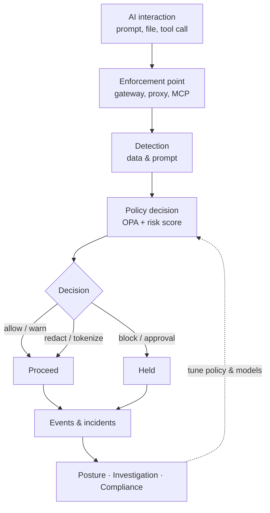

# Welcome to WANTIMPRES-26

{.home-logo}

**WANTIMPRES-26** is an *Enterprise AI Data Security & AI Security Posture Management* platform. It works like a security guard at the gate of the company's data: every AI interaction is inspected and weighed before sensitive data is allowed through. That covers prompts, file uploads, model responses, agent tool calls, and stored data that AI can reach.

The design comes from research into current industry standards and practice. Its main references are:

- OWASP Top 10 for LLM Applications 2025 and OWASP Top 10 for Agentic Applications 2026
- NIST AI RMF 1.0 and its Generative AI Profile (NIST AI 600-1)
- The Model Context Protocol (MCP) authorization specification, version 2026-07-28
- Indonesia's Personal Data Protection Law (UU 27/2022), OJK Regulation POJK 11/POJK.03/2022, and OJK's 2025 AI governance guide for Indonesian banking
- Product patterns from Forcepoint AI Security, Microsoft Purview DSPM, and Netskope One AI Security

With one policy decision point, one detection layer, and many enforcement points, WANTIMPRES-26 helps the organisation adopt AI quickly without losing control of customer data, credentials, and intellectual property.

## Get started

Choose a reading path. The documentation covers the company profile, the technical specification, and the implementation tickets.

  <a class="card" href="./about/vision-mission">
    <h3>Vision & Mission</h3>
    
Where WANTIMPRES-26 is heading and the commitments behind every design decision.

  </a>
  <a class="card" href="./about/philosophy">
    <h3>Name & Logo Philosophy</h3>
    
What the WANTIMPRES-26 acronym stands for and what the security guard in the logo means.

  </a>
  <a class="card" href="./spec">
    <h3>Specification</h3>
    
PRD, SRS, architecture, data model, APIs, ML pipeline, security, and compliance in one document.

  </a>
  <a class="card" href="./tickets/">
    <h3>Tickets & Roadmap</h3>
    
Implementation tickets by milestone, M0 to M4, with status and dependencies.

  </a>

## The core mechanism

WANTIMPRES-26 does not rely on a single filter. Every enforcement point runs a closed loop: capture the interaction, recognise its content, weigh its risk, carry out the decision, then record everything so the next decision is better.

Policy decisions are deliberately separated from enforcement. Every enforcement point asks the same decision point, so one policy applies across every channel.

## What it protects

- **AI visibility:** an AI app catalog, *shadow AI* discovery, and an agent inventory.
- **Sensitive data:** Indonesian national IDs (NIK), tax IDs (NPWP), bank accounts, card numbers, credentials, and source code are recognised before they leave.
- **Attacks on LLMs:** direct and indirect prompt injection, jailbreaks, system prompt leakage, and *excessive agency*.
- **Autonomous agents:** identity, least privilege, short-lived credentials, human approval, and a kill switch.
- **Compliance evidence:** a hash-chained audit log, control mapping, and a 72-hour data breach notification workflow.

## Next steps

- [Vision & Mission](./about/vision-mission): start with what the platform is for.
- [Full Specification](./spec): read the architecture and requirements end to end.
- [Ticket Overview](./tickets/): see what is in progress and what comes next.
- [Interactive Architecture](https://sivi-shahab.github.io/AI-Security/architecture/): explore the searchable, traceable platform diagram.
