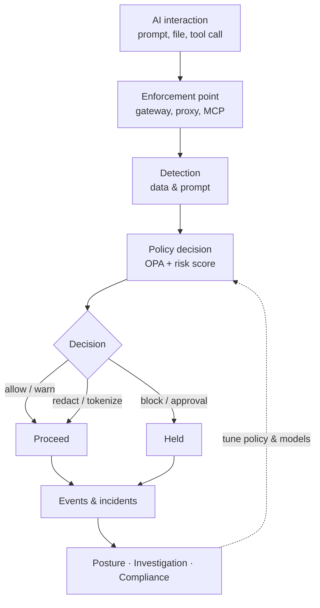

## How it works

WANTIMPRES-26 does not rely on a single filter. Every enforcement point runs a closed loop: capture the interaction, recognise its content, weigh its risk, carry out the decision, then record everything so the next decision is better.

Inspected interactions cover prompts, file uploads, model responses, agent tool calls, and stored data that AI can reach. Full details are in the [Specification](./spec) and the [Interactive Architecture](https://sivi-shahab.github.io/WANTIMPRES-26/architecture/).

## Design basis

The design comes from research into current industry standards and practice. Its main references are:

- OWASP Top 10 for LLM Applications 2025 and OWASP Top 10 for Agentic Applications 2026
- NIST AI RMF 1.0 and its Generative AI Profile (NIST AI 600-1)
- The Model Context Protocol (MCP) authorization specification, version 2026-07-28
- Indonesia's Personal Data Protection Law (UU 27/2022), OJK Regulation POJK 11/POJK.03/2022, and OJK's 2025 AI governance guide for Indonesian banking
- Product patterns from Forcepoint AI Security, Microsoft Purview DSPM, and Netskope One AI Security

With one policy decision point, one detection layer, and many enforcement points, WANTIMPRES-26 helps the organisation adopt AI quickly without losing control of customer data, credentials, and intellectual property.

## Choose your path

| I want to… | Start with |
| --- | --- |
| Understand the problems it solves and how it differs from DLP & LLM gateways | [Why WANTIMPRES-26](./guide/why) |
| Build from source, run the local stack, or deploy to Kubernetes | [Installation](./guide/install) |
| Connect apps and agents, manage policies, run SOC operations | [How to Use](./guide/how-to-use) |
| Get short answers on privacy, data location, integration, and compliance | [FAQ](./guide/faq) |
| Understand where the platform is heading and what its name and logo mean | [Vision & Mission](./about/vision-mission) · [Name & Logo Philosophy](./about/philosophy) |
| Read the PRD, SRS, architecture, APIs, and compliance end to end | [Full Specification](./spec) |
| See what is in progress and what comes next (M0–M4) | [Ticket Overview](./tickets/) |
| Explore the searchable, traceable platform diagram | [Interactive Architecture](https://sivi-shahab.github.io/WANTIMPRES-26/architecture/) |
