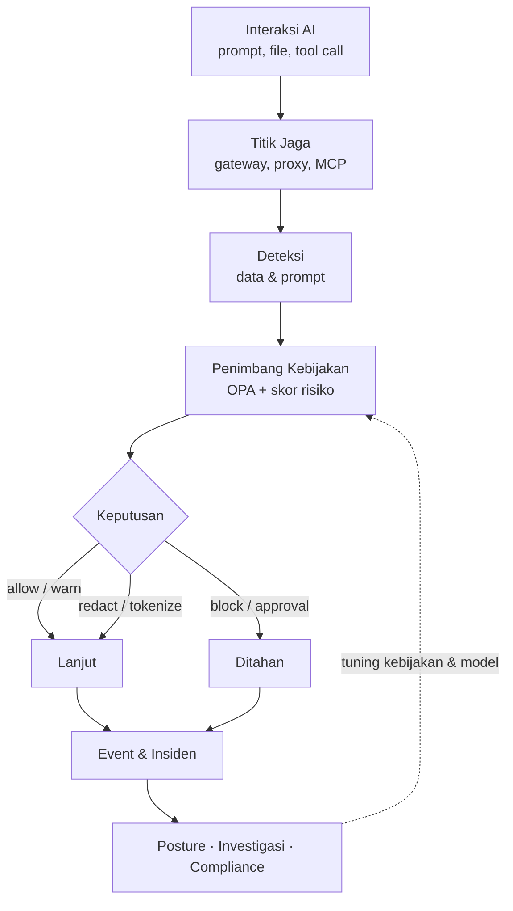

## Cara kerja

WANTIMPRES-26 tidak mengandalkan satu filter. Ia menjalankan siklus tertutup di setiap titik jaga: interaksi ditangkap, isinya dikenali, risikonya ditimbang, keputusan dijalankan, lalu semuanya dicatat sebagai bahan perbaikan.

Interaksi yang diperiksa mencakup prompt, unggahan file, response model, tool call agent, dan data yang tersimpan tetapi bisa dijangkau AI. Detail lengkapnya ada di [Spesifikasi](./spec) dan [Arsitektur Interaktif](https://sivi-shahab.github.io/WANTIMPRES-26/architecture/).

## Dasar rancangan

Rancangannya disusun dari riset atas standar dan praktik industri terbaru. Rujukan utamanya:

- OWASP Top 10 for LLM Applications 2025 dan OWASP Top 10 for Agentic Applications 2026
- NIST AI RMF 1.0 beserta Generative AI Profile (NIST AI 600-1)
- Spesifikasi otorisasi Model Context Protocol (MCP) versi 2026-07-28
- UU 27/2022 tentang Pelindungan Data Pribadi, POJK 11/POJK.03/2022, dan Panduan Tata Kelola Kecerdasan Artifisial Perbankan Indonesia (OJK, 2025)
- Pola produk Forcepoint AI Security, Microsoft Purview DSPM, dan Netskope One AI Security

Dengan satu titik keputusan kebijakan, satu lapisan deteksi, dan banyak titik jaga, WANTIMPRES-26 membantu organisasi memakai AI dengan cepat tanpa kehilangan kendali atas data nasabah, kredensial, dan kekayaan intelektual.

## Pilih jalur Anda

| Saya ingin… | Mulai dari |
| --- | --- |
| Tahu masalah yang dijawab dan pembedanya dari DLP & gateway LLM biasa | [Mengapa WANTIMPRES-26](./guide/why) |
| Build dari source, jalankan stack lokal, atau deploy ke Kubernetes | [Cara Instalasi](./guide/install) |
| Menghubungkan aplikasi dan agent, mengelola kebijakan, menjalankan SOC | [Cara Menggunakan](./guide/how-to-use) |
| Jawaban singkat soal privasi, lokasi data, integrasi, dan kepatuhan | [FAQ](./guide/faq) |
| Memahami arah platform serta arti nama dan logonya | [Visi & Misi](./about/vision-mission) · [Filosofi Nama & Logo](./about/philosophy) |
| Membaca PRD, SRS, arsitektur, API, dan compliance secara utuh | [Spesifikasi Lengkap](./spec) |
| Melihat apa yang sedang dan akan dikerjakan (M0–M4) | [Ringkasan Tiket](./tickets/) |
| Menjelajahi diagram platform yang bisa dicari dan ditelusuri | [Arsitektur Interaktif](https://sivi-shahab.github.io/WANTIMPRES-26/architecture/) |
