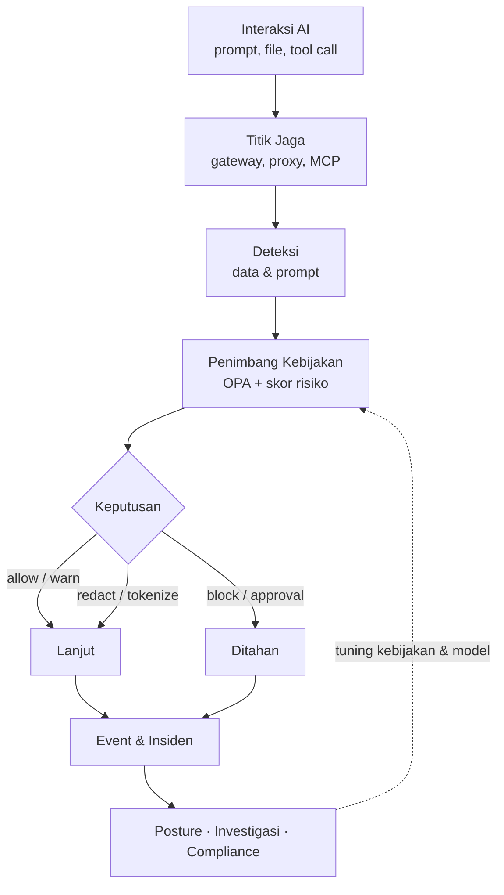

# Selamat Datang di WANTIMPRES-26

{.home-logo}

**WANTIMPRES-26** adalah platform *Enterprise AI Data Security & AI Security Posture Management*. Ia bertugas seperti penjaga keamanan di gerbang data perusahaan: setiap interaksi AI diperiksa dan ditimbang dulu sebelum data sensitif boleh lewat. Interaksi yang diperiksa mencakup prompt, unggahan file, response model, tool call agent, dan data yang tersimpan tetapi bisa dijangkau AI.

Rancangannya disusun dari riset atas standar dan praktik industri terbaru. Rujukan utamanya:

- OWASP Top 10 for LLM Applications 2025 dan OWASP Top 10 for Agentic Applications 2026
- NIST AI RMF 1.0 beserta Generative AI Profile (NIST AI 600-1)
- Spesifikasi otorisasi Model Context Protocol (MCP) versi 2026-07-28
- UU 27/2022 tentang Pelindungan Data Pribadi, POJK 11/POJK.03/2022, dan Panduan Tata Kelola Kecerdasan Artifisial Perbankan Indonesia (OJK, 2025)
- Pola produk Forcepoint AI Security, Microsoft Purview DSPM, dan Netskope One AI Security

Dengan satu titik keputusan kebijakan, satu lapisan deteksi, dan banyak titik jaga, WANTIMPRES-26 membantu organisasi memakai AI dengan cepat tanpa kehilangan kendali atas data nasabah, kredensial, dan kekayaan intelektual.

## Mulai

Pilih jalur bacaan. Dokumentasi terbagi menjadi profil perusahaan, spesifikasi teknis, dan tiket implementasi.

  <a class="card" href="./about/vision-mission">
    <h3>Visi & Misi</h3>
    
Arah yang dituju WANTIMPRES-26 dan komitmen yang menuntun setiap keputusan desainnya.

  </a>
  <a class="card" href="./about/philosophy">
    <h3>Filosofi Nama & Logo</h3>
    
Arti akronim WANTIMPRES-26 dan makna sosok penjaga keamanan pada logo.

  </a>
  <a class="card" href="./spec">
    <h3>Spesifikasi</h3>
    
PRD, SRS, arsitektur, model data, API, pipeline ML, keamanan, dan compliance dalam satu dokumen.

  </a>
  <a class="card" href="./tickets/">
    <h3>Tiket & Roadmap</h3>
    
Tiket implementasi per milestone, M0 sampai M4, lengkap dengan status dan dependensi.

  </a>

## Mekanisme Inti

WANTIMPRES-26 tidak mengandalkan satu filter. Ia menjalankan siklus tertutup di setiap titik jaga: interaksi ditangkap, isinya dikenali, risikonya ditimbang, keputusan dijalankan, lalu semuanya dicatat sebagai bahan perbaikan.

Keputusan kebijakan sengaja dipisahkan dari penegakannya. Semua titik jaga bertanya ke penimbang yang sama, sehingga satu kebijakan berlaku di semua kanal.

## Yang Dijaga

- **Visibilitas AI:** katalog aplikasi AI, deteksi *shadow AI*, dan inventaris agent.
- **Data sensitif:** NIK, NPWP, rekening, PAN, kredensial, dan kode sumber dikenali sebelum keluar.
- **Serangan pada LLM:** prompt injection langsung maupun tidak langsung, jailbreak, kebocoran system prompt, dan *excessive agency*.
- **Agent otonom:** identitas, *least privilege*, kredensial berumur pendek, persetujuan manusia, dan *kill switch*.
- **Bukti kepatuhan:** audit log dengan hash chain, pemetaan kontrol, dan alur notifikasi pelanggaran data 3×24 jam.

## Langkah Berikutnya

- [Visi & Misi](./about/vision-mission): mulai dari tujuan platform.
- [Spesifikasi Lengkap](./spec): baca arsitektur dan requirement secara utuh.
- [Ringkasan Tiket](./tickets/): lihat apa yang sedang dan akan dikerjakan.
- [Arsitektur Interaktif](https://sivi-shahab.github.io/AI-Security/architecture/): jelajahi diagram platform yang bisa dicari dan ditelusuri.
